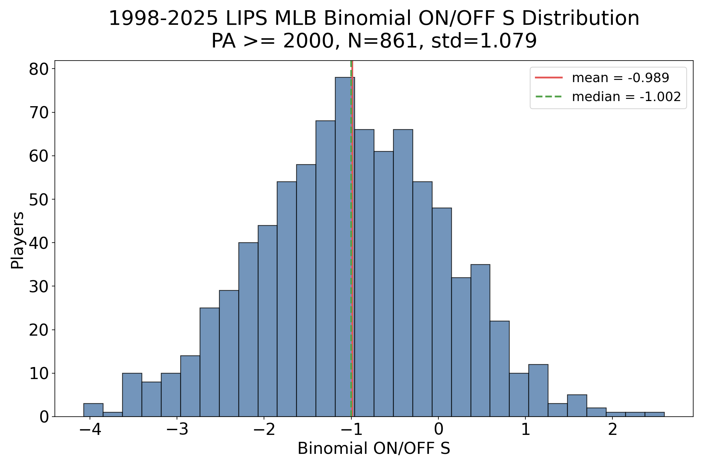
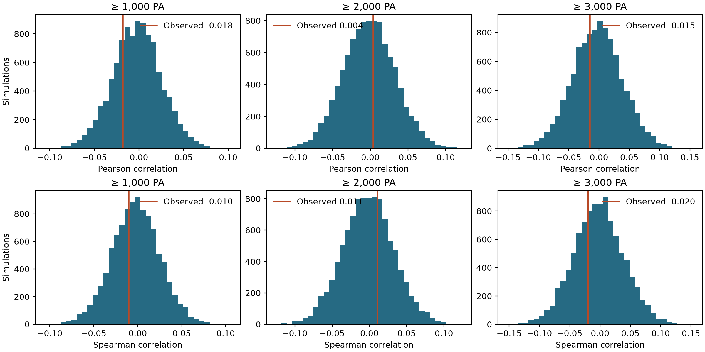

# A Method for Identifying Clutch Hitters

Classic approaches to identifying clutch hitters include Cramer's expected PWA framework and Ruane's direct RISP vs. non-RISP comparison. Ruane's RISP definition could later be replaced by LIPS, or supplemented with a LIPS-based analysis. This project explores whether ideas from astrophysical ON/OFF analysis can be used to statistically improve Ruane-style within-player comparisons.

In astrophysical counting experiments, the number of events observed in an ON region, where a source is expected to be present, is compared against the number of events observed in an OFF region, which serves as a background or control region. When the two regions differ in size, observation time, or effective exposure, an exposure ratio is used to account for that imbalance. Li-Ma significance is one representative method built for this kind of problem. Translating the broader ON/OFF philosophy to baseball suggests a way to compare each player's own clutch and non-clutch performance directly, rather than relying primarily on how that player performed relative to the entire league.

The current implementation replaces the original Poisson Li-Ma formula with a binomial ON/OFF likelihood-ratio statistic. This should be understood as a Li-Ma-style ON/OFF adaptation for two binomial samples, not as the original Li-Ma significance itself. The statistic compares each player's clutch and non-clutch success probabilities while accounting for the number of observed successes and failures in both samples.

## Repository Layout

```text
.
├── Data/
│   ├── Retrosheet/Compact/              # 1998-2025 compact MLB PA extracts
│   ├── Retrosheet/Raw/                  # Local Retrosheet zip downloads, ignored by git
│   ├── mlb_1998_2025_RISP_sample_counts.csv
│   └── mlb_2025_RISP_sample_counts.csv
├── Script/
│   ├── download_retrosheet_csv.py
│   ├── build_retrosheet_pa_compact.py   # Build compact PA data from Retrosheet event files
│   ├── build_retrosheet_pa_compact_range.py
│   ├── build_league_RISP_sample_counts.py
│   ├── lima_histogram_RISP_sample.py    # Core RISP labeling and binomial ON/OFF S helpers
│   ├── plot_RISP_histogram.py
│   └── analyze_risp_lips.py            # Step 1 EDA and overlap-aware simulation
├── Results/RISP_LIPS/                 # Generated tables and figures
├── docs/                              # Methods and mathematical derivation
├── tests/                             # Statistical and integrity tests
├── AGENTS.md
├── cle_2026_07_plate_appearances_compact.csv
└── cle_2026_07_statcast_pitches_raw.csv
```

## Method

The working derivation for the binomial ON/OFF likelihood-ratio statistic is saved in [`docs/binomial_on_off_likelihood_derivation.md`](docs/binomial_on_off_likelihood_derivation.md).

For each hitter:

- `n`: plate appearances with a runner on second and/or third
- `b`: plate appearances without RISP
- `n_trials`: RISP successes plus failures, excluding walks, hit by pitch, catcher interference, and sacrifice bunts
- `b_trials`: non-RISP successes plus failures under the same event filter
- `n_rate`: success rate in RISP plate appearances
- `b_rate`: success rate in non-RISP plate appearances
- `S`: signed binomial ON/OFF likelihood-ratio statistic comparing `n_rate` with `b_rate`

Success events currently include singles, doubles, triples, and home runs. Walks, hit by pitch, catcher interference, and sacrifice bunts are excluded from the success-rate denominator.

## Reproduce

Create an environment and install dependencies:

```bash
python3 -m venv .venv
source .venv/bin/activate
pip install -r requirements.txt
```

The repository includes the compact Retrosheet plate-appearance files for
1998–2025. From the repository root, regenerate the two player summaries
into a separate directory and plot the career sample using these commands.

```bash
python Script/build_league_RISP_sample_counts.py --input-glob "Data/Retrosheet/Compact/mlb_*_plate_appearances_compact.csv" --situation risp --output results/risp.csv
python Script/build_league_RISP_sample_counts.py --input-glob "Data/Retrosheet/Compact/mlb_*_plate_appearances_compact.csv" --situation lips --output results/lips.csv
python Script/plot_RISP_histogram.py --input results/risp.csv --min-pa 2000
python Script/plot_RISP_histogram.py --input results/lips.csv --min-pa 2000
```

To rebuild the compact inputs from Retrosheet's parsed play-by-play files,
download the source archives and run the compact builder.

```bash
python Script/download_retrosheet_csv.py --start-year 1998 --end-year 2025
python Script/build_retrosheet_pa_compact_range.py --start-year 1998 --end-year 2025
```

## Current Snapshot

RISP means a runner on second or third before the final pitch. LIPS means
the seventh inning or later with the batting team trailing by up to three
runs, tied, or ahead by one run. It also includes a four-run deficit with
the bases loaded at the start of the plate appearance.

| Career PA cutoff | Hitters | RISP mean S | RISP SD | LIPS mean S | LIPS SD |
|---:|---:|---:|---:|---:|---:|
| 1,000 | 1,343 | −0.163 | 1.054 | −0.895 | 1.079 |
| 2,000 | 861 | −0.212 | 1.051 | −0.989 | 1.079 |
| 3,000 | 595 | −0.250 | 1.060 | −1.092 | 1.108 |

Across all eligible batting trials, the pooled hit rate was 25.28% in
RISP and 25.62% outside RISP. The corresponding LIPS rates were 24.14%
and 25.81%. These are descriptive league rates and reflect differences
in which hitters, pitchers, and game states enter each sample. The
denominator includes sacrifice flies, so the rates use the success
definition in this repository.

Among the 861 hitters with at least 2,000 PA, the player-level RISP and
LIPS scores had a Pearson correlation of 0.004 and a Spearman correlation
of 0.011. These are descriptive correlations. The two scores share some
plate appearances, and the comparison has yet to account for that overlap.

For each player with a defined score, the squared score agreed with an
independently calculated two-proportion likelihood-ratio G statistic
within 3e-12, and the sign matched the difference in hit rates. The
current score tests equal hit probabilities for the two situations
within a player. Identifying individual hitters with repeatable clutch
skill would also require calibration, accounting for multiple comparisons
and league context, and a repeatability analysis.




### RISP–LIPS Exploratory Data Analysis and Correlation Analysis

Reproduce the tables and figures with the tracked 1998–2025 inputs.

```bash
python Script/analyze_risp_lips.py --simulations 10000 --seed 20251113
python -m unittest discover -s tests
```

The [analysis methods](docs/risp_lips_exploratory_analysis.md) describe the
scope, paired sample, interval estimators, and overlap model. The
[generated results](Results/RISP_LIPS/) contain the merged player dataset,
four-category counts, integrity checks, summary tables, and figures.

#### 1. Exploratory Data Analysis

How do score distributions and player profiles differ between RISP and LIPS?
The summaries matched on all 5,716 Retrosheet batter IDs and total PA counts.
Of these, 4,010 had both scores defined. All hitters meeting each of the
three PA thresholds had defined scores for both situations. Aggregating the
four disjoint categories back to RISP and LIPS reproduced the published
marginal counts across 4,569,453 eligible batting trials.

LIPS scores shifted lower at each cutoff. The greater exposure to strong
relief pitchers in late, close games is one possible explanation. The
analysis did not test that explanation. At 2,000 PA, Allen Craig led RISP
(S = 3.198) and Paul DeJong led LIPS (S = 2.592). Casey Blake and Jermaine
Dye had the lowest RISP and LIPS scores, respectively. Freddie Freeman had
the largest RISP-minus-LIPS gap (2.588 versus −3.487). Travis Lee had the
largest gap in the other direction (−2.335 versus 1.557). Full
[distribution statistics](Results/RISP_LIPS/descriptive_statistics.csv)
and [extreme results](Results/RISP_LIPS/extremes.csv) include the
sensitivity cutoffs.


#### 2. Correlation Analysis

How closely do hitters' results align in the two situations? The signed
score measures evidence for a rate difference, while the raw difference
measures its size. The two sets of coefficients were near zero at all
three cutoffs.

| Career PA cutoff | Hitters | Score Pearson | Score Spearman | Raw difference Pearson | Raw difference Spearman | Score top / bottom overlap |
|---:|---:|---:|---:|---:|---:|---:|
| 1,000 | 1,343 | −0.018 | −0.010 | −0.040 | −0.017 | 2 / 4 (of 68 per tail) |
| 2,000 | 861 | 0.004 | 0.011 | 0.016 | 0.027 | 2 / 4 (of 44 per tail) |
| 3,000 | 595 | −0.015 | −0.020 | 0.006 | −0.008 | 1 / 2 (of 30 per tail) |

For the primary sample, the 95% intervals for Pearson and Spearman score
correlations were [−0.063, 0.071] and [−0.059, 0.076]. Conventional two-sided
p-values against zero were 0.900 and 0.750. The
[correlation table](Results/RISP_LIPS/correlations.csv) includes all
intervals and conventional p-values. The [tail overlap table](Results/RISP_LIPS/tail_overlap.csv)
also includes the raw rate differences.


#### 3. Statistical Hypothesis Testing

Does observed score correlation exceed what random hit variation and shared
plate appearances can explain? In each of 10,000 draws, a hitter's pooled
hit rate and four observed trial counts determine the simulated hits. Both
scores use the same draw. The observations fell inside the central 95%
null intervals across all cutoffs.

| Method at 2,000 PA | Observed | Mean under null | Central 95% null interval | Observed minus null mean | One-sided p |
|---|---:|---:|---:|---:|---:|
| Pearson | 0.0043 | −0.0018 | [−0.0687, 0.0659] | 0.0060 | 0.432 |
| Spearman | 0.0109 | −0.0016 | [−0.0685, 0.0671] | 0.0125 | 0.359 |

The analysis found no evidence of positive excess correlation under the
specified model. The null assumes a constant success probability for each
hitter and omits league-wide situational effects, opponent quality, and
other context. This comparison does not measure season-to-season
repeatability. See the [Monte Carlo results](Results/RISP_LIPS/null_summary.csv)
for all cutoffs.



## Planned Analyses

The roadmap is organized around career-level analyses. The immediate priorities are to validate the existing marginal binomial ON/OFF statistics, investigate RISP/LIPS distributional behavior and league-wide baselines, develop a joint RISP–LIPS likelihood-ratio model, evaluate whether a directional joint clutch index can be statistically justified, compare the resulting measures with established sabermetric approaches, and then pursue upper-limit and secondary extensions.

### Statistical validation and sensitivity analysis

The current ON/OFF statistic uses a binomial likelihood for two independent success/failure samples and is mathematically equivalent to a standard two-proportion likelihood-ratio, or G, test. The Li-Ma connection is methodological motivation from the ON/OFF likelihood-ratio framework; the likelihood used here is binomial rather than Poisson.

- Evaluate marginal score calibration separately from the overlap-aware population correlation test.
- Compare the mean, median, standard deviation, skewness, and positive/negative tail fractions at thresholds such as `|S| > 2` and `|S| > 3`.
- Optionally examine the robustness of career-level significance using leave-one-season-out analyses.
- Distinguish this robustness check from year-to-year repeatability of player-specific clutch skill, which is a separate question.
- Address multiple testing across players using an appropriate method, such as false discovery rate control or population-level null simulations.

### Additional RISP and LIPS comparisons

- Compare empirical standardized scores within each distribution and distinguish them from statistical detection significance.
- Investigate how the observed league-wide RISP and LIPS hit-rate gaps affect the significance distributions.

### Joint RISP–LIPS Likelihood-Ratio Analysis

The current implementation computes two separate career-level signed binomial ON/OFF likelihood-ratio statistics: `S_R` for RISP versus non-RISP batting performance and `S_L` for LIPS versus non-LIPS batting performance. A combined measure such as `C_new = a S_R + b S_L` would require defensible weights and must account for overlapping observations and statistical dependence between the two situation definitions. Rather than assigning arbitrary weights or fitting them directly to an existing sabermetric metric, the next methodological objective is to investigate whether a combined clutch measure can be derived from a joint likelihood model. FanGraphs Clutch should be reserved for subsequent external comparison, not used as the primary training target for determining the new index.

Batting observations can be partitioned into four mutually exclusive categories according to RISP and LIPS indicators:

| Category | RISP | LIPS |
|---|---|---|
| A | No | No |
| B | Yes | No |
| C | No | Yes |
| D | Yes | Yes |

For each category, hits and eligible batting trials should be calculated using the same event-filtering rules used in the current marginal analyses. The number of hits in category `j` can then be modeled as `H_j ~ Binomial(N_j, p_j)`.

A binomial logistic model can represent conditional RISP and LIPS effects:

`logit(p_j) = beta_0 + beta_R I_RISP,j + beta_L I_LIPS,j`.

The coefficients represent conditional situational effects on batting success probability. The joint null hypothesis is

`H_0: beta_R = beta_L = 0`.

The likelihood-ratio statistic is

`TS_joint = 2 (log L_alternative - log L_null)`.

Under standard regularity conditions, the asymptotic null distribution is chi-square with two degrees of freedom. This is an established likelihood-ratio methodology applied to a joint baseball situational model, not a newly invented statistical test.

- Implement the four-category RISP/LIPS partition.
- Verify that every eligible batting observation is assigned to exactly one category.
- Fit the joint binomial logistic model for each eligible player.
- Calculate the joint likelihood-ratio statistic and estimate the RISP/LIPS coefficients.
- Evaluate finite-sample calibration using Monte Carlo simulations.
- Investigate whether an interaction term between RISP and LIPS is necessary.
- Compare the joint results with the existing marginal RISP and LIPS significance statistics.
- Examine league-wide situational effects and whether an adjusted null model is appropriate.
- Check player-level sample sizes and potential separation problems before assuming the four category probabilities can be estimated reliably.

### Proposed Joint Clutch Index

The project also aims to investigate a directional clutch index derived from the joint likelihood framework. This requires separating two related but distinct objects:

1. The joint likelihood-ratio statistic, which measures evidence against the null hypothesis that both situational effects are zero.
2. A directional clutch index, which would be intended to distinguish positive from negative situational batting performance.

The ordinary two-degree-of-freedom joint likelihood-ratio statistic is nonnegative and does not provide a natural sign. Constructing a signed index therefore requires an additional, explicitly justified definition of the direction of the combined effect.

Potential approaches for future investigation include:

- A prespecified linear contrast of the fitted RISP and LIPS coefficients.
- A constrained common-effect model, provided its assumptions can be justified.
- A covariance-aware directional statistic derived from the joint model.

No final directional index has been selected or validated. Any proposed index must be evaluated for statistical interpretation, null-distribution calibration, sensitivity to sample size, stability under different PA cutoffs, dependence on league-wide situational baselines, and potential double-counting of overlapping RISP/LIPS observations. A new directional index should not be labeled as a Z-score or statistical significance unless its calibration supports that interpretation.

### Comparison with established clutch metrics

This analysis should be compared with existing sabermetric clutch measurements, especially FanGraphs Clutch and Ruane's RISP/non-RISP comparison using the difference in BPS (`BA + SLG`). FanGraphs Clutch is defined as `Clutch_FG = WPA / pLI - WPA / LI`.

The goal is to compare independently developed joint likelihood-based clutch measures with established metrics. FanGraphs Clutch should not be used to train the coefficients of the proposed joint index in the primary methodology; it should remain an external comparison benchmark.

- Obtain FanGraphs Clutch measurements for a period matching the Retrosheet dataset (1998-2025), subject to data availability.
- Match FanGraphs player identifiers with Retrosheet player identifiers.
- Match players and analysis periods across the different metrics.
- Compare the existing marginal RISP/LIPS significance statistics with FanGraphs Clutch.
- Compare the proposed directional joint clutch index with FanGraphs Clutch after the index has been statistically defined and validated.
- Calculate Pearson and Spearman correlations between RISP significance, LIPS significance, the proposed joint measures, and established clutch metrics.
- Generate scatter plots and compare overlap among top-ranked, bottom-ranked, and extreme performers.
- Identify players whose likelihood-based rankings differ substantially from their FanGraphs Clutch ranking.
- Evaluate whether the joint index provides information distinct from existing win-probability-based metrics.
- Consider the influence of career length and batting opportunities on cross-metric comparisons.
- Discuss differences in the underlying estimands: statistical evidence for batting-average changes versus situational run or win contributions.
- Do not treat the unsigned joint likelihood-ratio statistic as directly equivalent to signed FanGraphs Clutch. If the unsigned statistic is compared with the magnitude of FanGraphs Clutch, the limitations of that comparison should be stated explicitly.
- Avoid claiming that the proposed framework is superior solely because it produces a likelihood-ratio significance.

### Upper limits

- Set upper limits for player-specific clutch effects after the null calibration and league-wide situational baseline checks are complete.

## Data Notes

The compact 1998-2025 plate-appearance extracts are derived from Retrosheet parsed play-by-play CSV files. Retrosheet terms and attribution should be followed for any public use of their source data.
