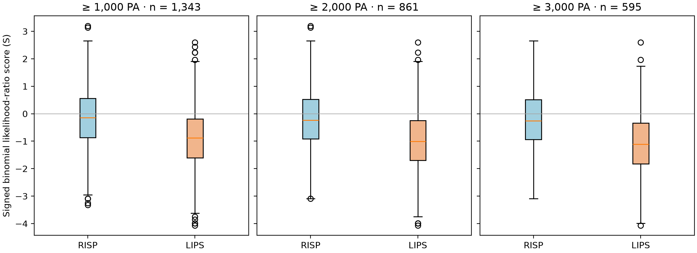
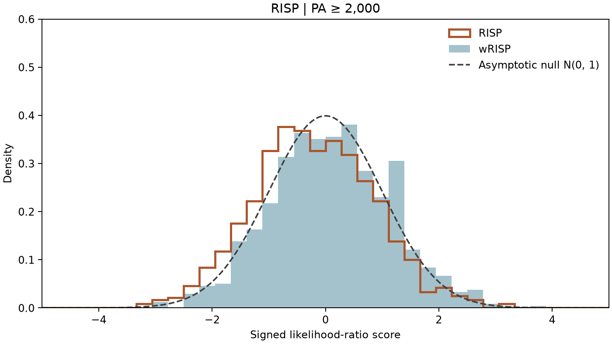
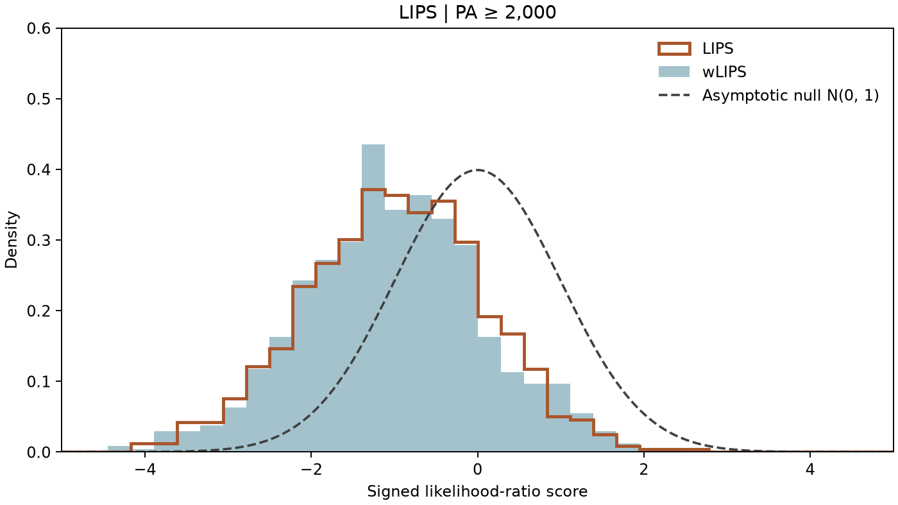
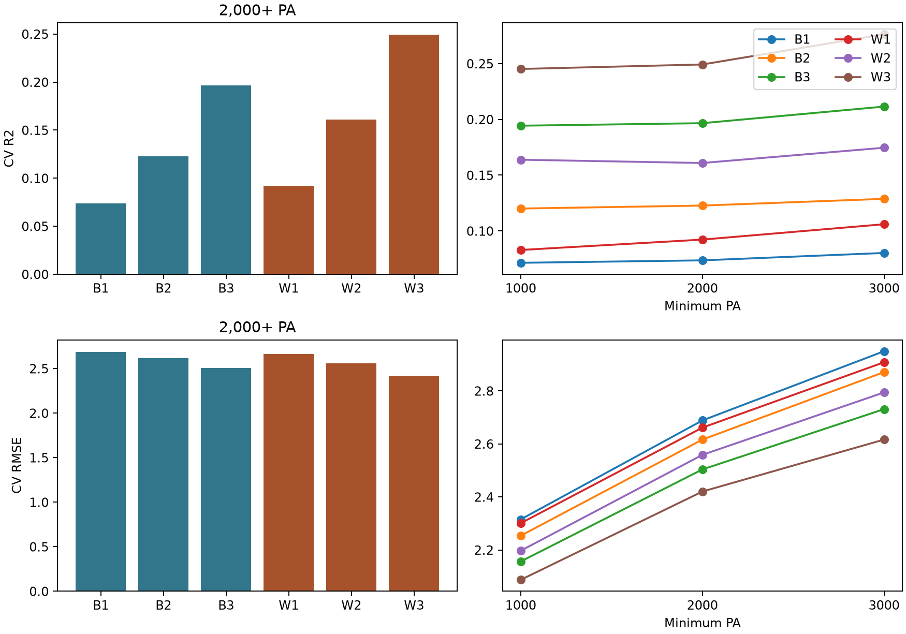

# A Method for Identifying Clutch Hitters

## Project Overview

How does a hitter’s performance change in different game situations? This
project adapts the astrophysical ON/OFF framework to compare each hitter’s
hit rate in a defined situation with their hit rate in all other situations.

## Dataset

The 1998–2025 Retrosheet play-by-play extracts cover **5,716 hitters** and
**4,569,453 eligible batting trials**. The primary analysis includes 861 hitters
with at least 2,000 career plate appearances (PA).

- **RISP (runners in scoring position)** means a runner is on second or third before the final pitch.
- **LIPS (late-inning pressure situations)** means the seventh inning or later, with the batting team ahead by one, tied, or trailing by up to three. A four-run deficit also qualifies if the bases are loaded at the start of the PA.

## Statistical Methodology

The signed binomial ON/OFF score is the square root of the standard
two-proportion likelihood-ratio G statistic, with the sign of the ON-minus-OFF
hit-rate difference. It uses the astrophysical ON/OFF comparison with a
binomial likelihood for hits and failures. See the [mathematical derivation](docs/methodology/binomial_on_off.md).

### Detection and upper limits

The signed binomial ON/OFF score adapts the Li–Ma detection framework
to situational hit rates. Step 2 adds a Zech-inspired Bayesian binomial
upper limit on the ON-minus-OFF hit-rate difference. The 95% limit
bounds the effect conditional on it being positive. The posterior
probability of a positive effect is reported separately.
[Derivation](docs/methodology/binomial_upper_limit.md) ·
[Step 2 results](docs/analysis/02_upper_limit_analysis.md)

### Weighted ON/OFF framework

The original binomial model gives every hit a value of 1 and excludes
walks and hit-by-pitches. The weighted framework includes unintentional
walks and hit-by-pitches and gives each hit type its own weight.

A representative set of Baseball-Reference batting outcome weights for
1998–2025 could not be obtained. The study adopts the fixed weights from
FanGraphs Basic wOBA and retains Baseball-Reference Clutch as the external
benchmark.

| Batting outcome | Original binomial weight | New fixed weight |
|---|---:|---:|
| Out / ROE | 0 | 0.00 |
| Unintentional BB | Excluded | 0.70 |
| HBP | Excluded | 0.70 |
| Single | 1 | 0.90 |
| Double | 1 | 1.25 |
| Triple | 1 | 1.60 |
| Home run | 1 | 2.00 |

Jeff Zimmerman (2015), [Basic wOBA Equation](https://blogs.fangraphs.com/instagraphs/basic-woba-equation/), FanGraphs, May 14, 2015.
Zimmerman reported R² = 0.986 between Basic wOBA and actual wOBA for
players with more than 200 plate appearances since 1980, supporting the
use of fixed coefficients across seasons.

The framework adapts Basic wOBA by using its published coefficients with
the project's own eligible PA definition. Intentional walks, sacrifice
bunts, and catcher interference are excluded. Sacrifice flies and
reaching on error count as zero. All singles receive the published
single weight of 0.90.

For each ON or OFF sample, weighted batting production is

```text
μ = Σᵢ wᵢpᵢ = (Σᵢ wᵢNᵢ)/T
```

Here `Nᵢ` is the outcome count, `T` is the total number of eligible trials,
and `pᵢ = Nᵢ/T`. The raw weighted difference is `μ_ON − μ_OFF`. A group
with zero eligible trials has an undefined mean.

The fixed-weight framework assigns identical values to equivalent batting
outcomes across all seasons. A home run in 1998 and one in 2025 both receive
a weight of 2.00 regardless of differences in the offensive environment.
[Appendix A.1 methodology](docs/analysis/appendix_a_1_weighted_on_off.md)

The binomial statistic compares hit probabilities. The weighted multinomial
statistic compares weighted production means across seven outcomes and allows
different ON and OFF distributions under the null. In 100,000 validation
fits there were no optimizer failures. Nominal 5% rejection was 4.57–5.24%
in the five realistic null configurations and 1.63% in the sparse case.
[Multinomial derivation](docs/methodology/multinomial_on_off.md) ·
[Appendix A.2 validation](docs/analysis/appendix_a_2_weighted_validation.md)

## Key Findings

LIPS scores shifted lower than RISP scores at all three PA cutoffs. The signed
scores and raw hit-rate differences showed near-zero correlations. In 10,000
simulations that preserved shared batting trials, the observed score
correlations fell within the central 95% null intervals.

| Result for hitters with ≥ 2,000 PA | Estimate |
|---|---:|
| Mean signed score, RISP / LIPS | −0.212 / −0.989 |
| Observed score correlation, Pearson / Spearman | 0.0043 / 0.0109 |
| Overlap-aware null mean, Pearson / Spearman | −0.0018 / −0.0016 |
| One-sided p-value for positive excess, Pearson / Spearman | 0.432 / 0.359 |



### Bayesian upper limits

At PA ≥ 2,000 and signed score S < 3, the median conditional 95%
upper limit is 3.17 percentage points for RISP (859 players) and
2.91 for LIPS (861 players). The limit complements the signed score
by bounding the size of a positive effect under the model.
[Upper-limit analysis](docs/analysis/02_upper_limit_analysis.md)

### External benchmark

Against Baseball-Reference Clutch at 2,000 PA, Pearson r was 0.276 for
RISP and 0.354 for LIPS. The one-sided Williams test gave p = 0.041, and
the two-sided bootstrap 95% interval for the difference was [−0.013, 0.167].
[Step 3 results](docs/analysis/03_external_benchmark.md)

At 2,000 PA, combining RISP and LIPS yielded Pearson r = 0.448 and
R² = 0.201 in sample. Five-fold validation yielded r = 0.443 and R² =
0.197, compared with R² = 0.123 for LIPS alone.
[Regression extension](docs/analysis/03_external_benchmark.md#regression-extension)

### Overall batting performance dependence

At 2,000 PA, WPA correlates about 0.84 with both OPS+ and wRC+.
The Clutch estimates have weaker negative correlations (−0.262 and
−0.253), and the ON/OFF scores have smaller point-estimate magnitudes
on these broader production indexes. The overall hit-rate results
show a different pattern. Adjusted comparisons most clearly support
a reduction for weighted RISP.
[Step 3 extension](docs/analysis/03_external_benchmark.md#dependence-on-overall-batting-performance)

### Weighted baseline

The original and weighted analyses use 4,569,453 and 5,019,958 eligible
trials, respectively. Across the league, pooled RISP ON-minus-OFF changes from
−0.00343 in hit rate to +0.00260 in weighted production, while the LIPS
comparison remains negative. Across all three cutoffs, wRISP averages
slightly above zero and wLIPS averages below zero.

| At least 2,000 PA (861 hitters) | Binomial mean (SD) | Weighted mean (SD) |
|---|---:|---:|
| RISP | −0.212 (1.051) | +0.102 (1.051) |
| LIPS | −0.989 (1.079) | −1.009 (1.083) |





### Weighted external benchmark

At 2,000 PA, the weighted combined model raised pooled CV R² from
0.197 to 0.249, a difference of 0.053 (paired bootstrap 95% interval
[0.028, 0.078]). CV RMSE fell from 2.504 to 2.420. The weighted scores
remain nearly uncorrelated with each other (Pearson r = 0.016).
[Appendix A.4 methodology and results](docs/analysis/appendix_a_4_weighted_benchmark.md)

| Model | In-sample Pearson r | In-sample R² | CV Pearson r | CV R² | CV RMSE | CV MAE |
|---|---:|---:|---:|---:|---:|---:|
| RISP | 0.276 | 0.076 | 0.271 | 0.074 | 2.689 | 2.097 |
| LIPS | 0.354 | 0.125 | 0.350 | 0.123 | 2.616 | 2.034 |
| RISP + LIPS | 0.448 | 0.201 | 0.443 | 0.197 | 2.504 | 1.946 |
| wRISP | 0.308 | 0.095 | 0.304 | 0.092 | 2.661 | 2.071 |
| wLIPS | 0.405 | 0.164 | 0.401 | 0.161 | 2.559 | 1.981 |
| wRISP + wLIPS | 0.505 | 0.255 | 0.499 | 0.249 | 2.420 | 1.875 |



### Appendix B benchmark comparison

At PA ≥ 2,000, out-of-fold R² is 0.081 for Ruane's RISP BPS difference,
0.151 for paired raw hit-rate differences, 0.197 for binomial ON/OFF,
0.215 for paired raw weighted production differences, and 0.249 for
weighted multinomial ON/OFF, on the same samples and validation folds.
Binomial LIPS alone reaches 0.123, suggesting that late-inning pressure
captures information beyond RISP. The comparison applies Ruane's BPS
only to RISP and leaves its performance with LIPS open.
[Appendix B methodology and results](docs/analysis/appendix_b_benchmark_comparison.md)

## Analysis

| Analysis | Description | Status |
|---|---|---|
| [Baseline Analysis](docs/analysis/00_baseline_analysis.md) | Binomial ON/OFF statistics and significance distributions | Completed |
| [Step 1](docs/analysis/01_risp_lips_correlation.md) | RISP–LIPS EDA, correlation analysis, and hypothesis testing | Completed |
| [Step 2](docs/analysis/02_upper_limit_analysis.md) | Bayesian upper limits for binomial ON/OFF | Completed |
| [Step 3](docs/analysis/03_external_benchmark.md) | Baseball-Reference Clutch and WPA benchmark | Completed |
| [Appendix A.1](docs/analysis/appendix_a_1_weighted_on_off.md) | Fixed weights and weighted ON/OFF batting production | Completed |
| [Appendix A.2](docs/analysis/appendix_a_2_weighted_validation.md) | Weighted multinomial likelihood and calibration | Completed |
| [Appendix A.3](docs/analysis/appendix_a_3_weighted_baseline.md) | Weighted baseline and cutoff sensitivity | Completed |
| [Appendix A.4](docs/analysis/appendix_a_4_weighted_benchmark.md) | Weighted external benchmark and regression | Completed |
| [Appendix B](docs/analysis/appendix_b_benchmark_comparison.md) | Ruane BPS, raw differences, and ON/OFF benchmark comparison | Completed |

## Reproduction

From the repository root, create a virtual environment with
`python -m venv .venv` and activate it before running the following.

```bash
python -m pip install -r requirements.txt
python Script/analyze_risp_lips.py
python Script/analyze_upper_limits.py
python Script/analyze_external_benchmark.py
python Script/analyze_clutch_regression.py
python Script/prepare_weighted_on_off.py
python Script/validate_weighted_on_off.py --simulations 10000
python Script/analyze_weighted_baseline.py
python Script/analyze_weighted_benchmark.py --bootstrap 10000
python Script/analyze_appendix_benchmarks.py
python -m unittest discover -s tests
```

The script uses the included data. See the [baseline reproduction commands](docs/analysis/00_baseline_analysis.md#reproduction)
to rebuild the marginal summaries and histograms.

The Baseball-Reference benchmark sums published season WPA and estimates
period Clutch from season Win Probability statistics over 1998–2025.
See the [data README](Data/BaseballReference/README.md) for the aggregation
method, coverage, and reproduction command.

## Repository Structure

```text
.
├── README.md
├── AGENTS.md
├── Data/
├── Script/
│   ├── binomial_upper_limit.py
│   ├── analyze_upper_limits.py
│   ├── prepare_weighted_on_off.py
│   ├── multinomial_on_off.py
│   ├── validate_weighted_on_off.py
│   ├── analyze_weighted_baseline.py
│   ├── analyze_weighted_benchmark.py
│   └── analyze_appendix_benchmarks.py
├── Results/
│   ├── RISP_LIPS/
│   ├── Upper_Limits/
│   ├── External_Benchmark/
│   ├── Weighted_ON_OFF/
│   │   ├── fixed_weights.csv
│   │   ├── risp_player_counts.csv
│   │   ├── lips_player_counts.csv
│   │   ├── coverage.csv
│   │   ├── Validation/
│   │   ├── Baseline/
│   │   └── External_Benchmark/
│   └── Appendix_A/
├── docs/
│   ├── methodology/
│   │   ├── binomial_on_off.md
│   │   ├── binomial_upper_limit.md
│   │   └── multinomial_on_off.md
│   ├── analysis/
│   │   ├── 00_baseline_analysis.md
│   │   ├── 01_risp_lips_correlation.md
│   │   ├── 02_upper_limit_analysis.md
│   │   ├── 03_external_benchmark.md
│   │   ├── appendix_a_1_weighted_on_off.md
│   │   ├── appendix_a_2_weighted_validation.md
│   │   ├── appendix_a_3_weighted_baseline.md
│   │   ├── appendix_a_4_weighted_benchmark.md
│   │   └── appendix_b_benchmark_comparison.md
│   └── roadmap.md
└── tests/
```

## Roadmap

The main analysis covers detection, upper limits, and external benchmarking. Joint index development
remains deferred. [Roadmap](docs/roadmap.md)

## Data Sources and Attribution

The compact extracts are derived from Retrosheet’s parsed play-by-play CSV
files. Follow Retrosheet’s attribution and data-use terms when redistributing
the data or derived products. [Retrosheet CSV downloads and notices](https://retrosheet.org/downloads/csvdownloads.html).

> The information used here was obtained free of charge from and is copyrighted by Retrosheet.
