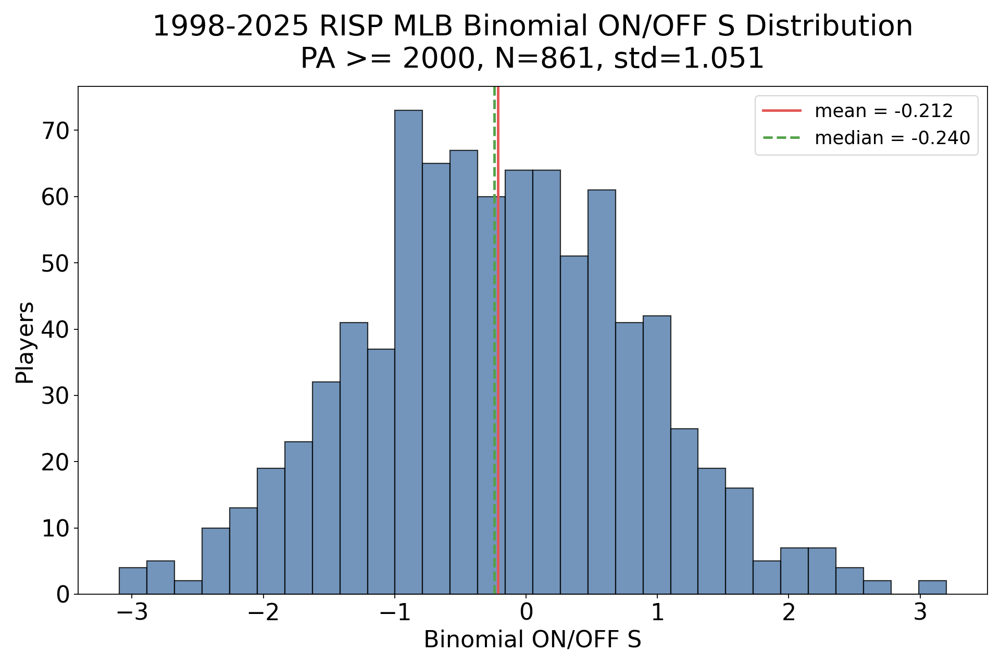
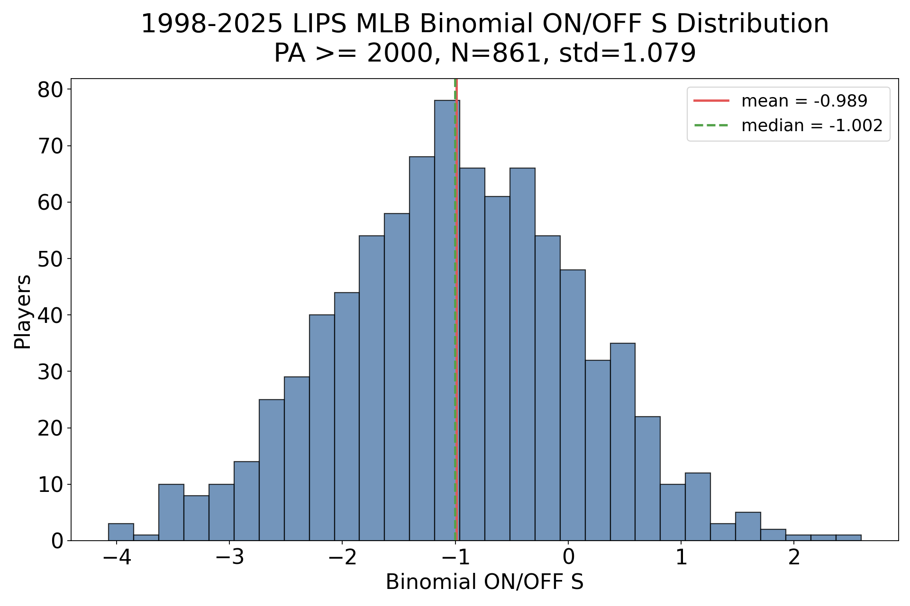

# A Method for Identifying Clutch Hitters

Classic approaches to identifying clutch hitters include Cramer's expected PWA framework and Ruane's direct RISP vs. non-RISP comparison. Ruane's RISP definition could later be replaced by LIPS, or supplemented with a LIPS-based analysis. This project explores whether ideas from astrophysical ON/OFF analysis can be used to statistically improve Ruane-style within-player comparisons.

In astrophysical counting experiments, the number of events observed in an ON region, where a source is expected to be present, is compared against the number of events observed in an OFF region, which serves as a background or control region. When the two regions differ in size, observation time, or effective exposure, an exposure ratio is used to account for that imbalance. Li-Ma significance is one representative method built for this kind of problem. Translating the broader ON/OFF philosophy to baseball suggests a way to compare each player's own clutch and non-clutch performance directly, rather than relying primarily on how that player performed relative to the entire league.

The current implementation replaces the original Poisson Li-Ma formula with a binomial ON/OFF likelihood-ratio statistic. This should be understood as a Li-Ma-style ON/OFF adaptation for two binomial samples, not as the original Li-Ma significance itself. The statistic compares each player's clutch and non-clutch success probabilities while accounting for the number of observed successes and failures in both samples.

## Repository Layout

```text
.
├── Data/
│   ├── Retrosheet/Compact/              # 1998-2025 compact MLB PA extracts
│   ├── Retrosheet/Raw/                  # Local Retrosheet zip downloads, ignored by git
│   ├── mlb_1998_2025_RISP_sample_counts.csv
│   └── mlb_2025_RISP_sample_counts.csv
├── Script/
│   ├── download_retrosheet_csv.py
│   ├── build_retrosheet_pa_compact.py   # Build compact PA data from Retrosheet event files
│   ├── build_retrosheet_pa_compact_range.py
│   ├── build_league_RISP_sample_counts.py
│   ├── lima_histogram_RISP_sample.py    # Core RISP labeling and binomial ON/OFF S helpers
│   └── plot_RISP_histogram.py
├── cle_2026_07_plate_appearances_compact.csv
└── cle_2026_07_statcast_pitches_raw.csv
```

## Method

The working derivation for the binomial ON/OFF likelihood-ratio statistic is saved in [`docs/binomial_on_off_likelihood_derivation.md`](docs/binomial_on_off_likelihood_derivation.md).

For each hitter:

- `n`: plate appearances with a runner on second and/or third
- `b`: plate appearances without RISP
- `n_trials`: RISP successes plus failures, excluding walks, hit by pitch, catcher interference, and sacrifice bunts
- `b_trials`: non-RISP successes plus failures under the same event filter
- `n_rate`: success rate in RISP plate appearances
- `b_rate`: success rate in non-RISP plate appearances
- `S`: signed binomial ON/OFF likelihood-ratio statistic comparing `n_rate` with `b_rate`

Success events currently include singles, doubles, triples, and home runs. Walks, hit by pitch, catcher interference, and sacrifice bunts are excluded from the success-rate denominator.

## Reproduce

Create an environment and install dependencies:

```bash
python3 -m venv .venv
source .venv/bin/activate
pip install -r requirements.txt
```

Download Retrosheet parsed CSV zip files:

```bash
python Script/download_retrosheet_csv.py --start-year 1998 --end-year 2025
```

Build compact plate-appearance files:

```bash
python Script/build_retrosheet_pa_compact_range.py --start-year 1998 --end-year 2025
```

Build the 1998-2025 player summary:

```bash
python Script/build_league_RISP_sample_counts.py \
  --input-glob 'Data/Retrosheet/Compact/mlb_*_plate_appearances_compact.csv' \
  --output Data/mlb_1998_2025_RISP_sample_counts.csv
```

Show the histogram:

```bash
python Script/plot_RISP_histogram.py
```

## Current Snapshot

The histograms below show career-level RISP and LIPS signed binomial ON/OFF significance for 1998-2025 hitters with at least 2000 career plate appearances. The RISP distribution remains relatively close to centered, while the LIPS distribution is shifted substantially negative. This shift is plausibly related to the fact that LIPS plate appearances occur in late and close game states, where hitters are more likely to face high-leverage relief pitchers. The league-wide LIPS/non-LIPS baseline should therefore be evaluated before interpreting player-level signs as clutch effects.





## Planned Analyses

### Statistical validation and sensitivity analysis

The current ON/OFF statistic uses a binomial likelihood for two independent success/failure samples and is mathematically equivalent to a standard two-proportion likelihood-ratio, or G, test. The Li-Ma connection is methodological motivation from the ON/OFF likelihood-ratio framework; the likelihood used here is binomial rather than Poisson.

- Validate the binomial ON/OFF statistic against the standard two-proportion likelihood-ratio (G) test.
- Perform Monte Carlo null simulations using observed ON/OFF trial counts to evaluate the calibration of the signed significance statistic.
- Conduct PA cutoff sensitivity analyses using career PA thresholds of 1000, 2000, and 3000. The current primary threshold is 2000 PA.
- Compare the mean, median, standard deviation, skewness, and positive/negative tail fractions at thresholds such as `|S| > 2` and `|S| > 3`.
- Examine the stability of career-level significance using leave-one-season-out analyses.
- Distinguish statistical robustness from year-to-year repeatability, which should be evaluated separately.
- Address multiple testing across players using an appropriate method, such as false discovery rate control or population-level null simulations.

### RISP and LIPS cross-validation

RISP and LIPS are separate clutch situation definitions. They are analyzed with the same binomial ON/OFF framework, but their baseline distributions need not be the same. For 1998-2025 career-level results with career PA >= 2000, the current player sample contains 861 hitters.

| Statistic | RISP | LIPS |
|---|---:|---:|
| Mean | -0.212 | -0.989 |
| Standard deviation | 1.051 | 1.079 |

- Calculate Pearson and Spearman correlations between player-level RISP and LIPS signed significance.
- Generate a player-level scatter plot comparing the two statistics.
- Compare the overlap of top-performing and bottom-performing players, including the top and bottom 5%.
- Compare empirical standardized scores within each distribution, while explicitly distinguishing these relative scores from statistical detection significance.
- Compare raw ON/OFF effect sizes, defined as batting-average differences, for RISP and LIPS.
- Quantify league-wide RISP/non-RISP and LIPS/non-LIPS baseline differences and investigate their effects on the significance distributions.
- Account for overlap between RISP and LIPS plate appearances when interpreting correlations. Null simulations or permutation methods should be used to evaluate whether observed agreement exceeds what would be expected from overlapping samples alone.
- Avoid automatically recentering the signed significance distributions and reinterpreting recentered values as statistical significance.

### Comparison with established clutch metrics

This analysis should be compared with existing sabermetric clutch measurements, especially FanGraphs Clutch, which is based on Win Probability Added and Leverage Index, and Ruane's RISP/non-RISP comparison using the difference in BPS (`BA + SLG`).

- Match players and analysis periods across the different metrics.
- Calculate Pearson and Spearman correlations between RISP significance, LIPS significance, and established clutch metrics.
- Generate scatter plots and compare overlap among top-ranked and bottom-ranked players.
- Identify players whose rankings differ substantially between the binomial ON/OFF significance and established clutch metrics.
- Discuss differences in the underlying estimands: statistical evidence for batting-average changes versus situational run or win contributions.
- Avoid claiming that the proposed framework is superior solely because it produces a likelihood-ratio significance.

### Upper limits

- Set upper limits for player-specific clutch effects after the null calibration and league-wide situational baseline checks are complete.

## Data Notes

The compact 1998-2025 plate-appearance extracts are derived from Retrosheet parsed play-by-play CSV files. Retrosheet terms and attribution should be followed for any public use of their source data.
