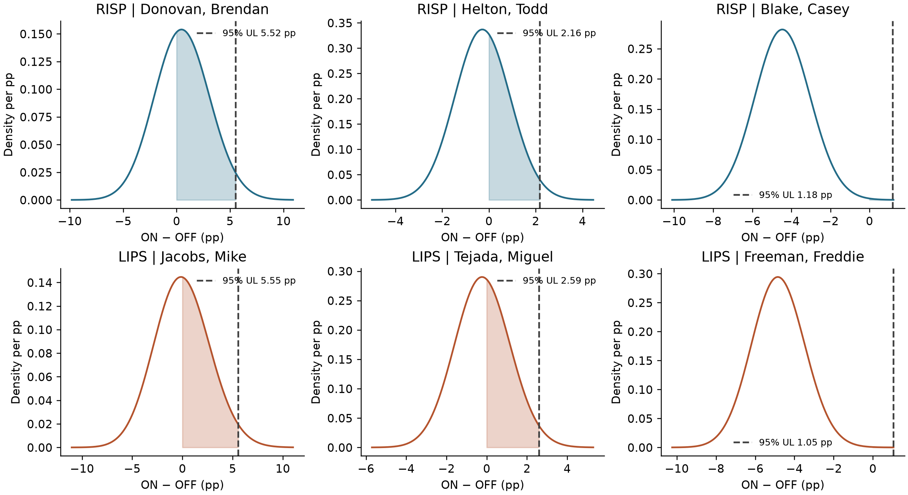

# A Method for Identifying Clutch Hitters

## What is a clutch hitter?

A clutch hitter performs better in important situations relative to their own ordinary performance. A hitter can produce more than their peers in a key plate appearance while performing below their own usual level. This project separates those questions by comparing each hitter's performance with runners in scoring position (RISP) and in late-inning pressure situations (LIPS) with their performance outside each situation.

The astrophysical ON/OFF framework gives each hitter their own baseline. For each situation, **ON** contains qualifying plate appearances and **OFF** contains the rest. A signed likelihood-ratio score measures evidence for improvement or decline while accounting for the number of observations and sampling variation. When the data do not establish a positive effect, a Bayesian upper limit describes how large a positive effect could still be. The aim is to reduce dependence on overall batting production while retaining a meaningful measure of situational performance.

## Data and statistical framework

The study uses Retrosheet play-by-play from the **1998–2025** MLB regular seasons, covering **5,716 hitters** and **4,569,453 binomial-eligible batting trials**. The total plate appearance (PA) cutoffs are 1,000, 2,000, and 3,000. The primary sample contains **861 hitters with at least 2,000 PA** within the study period. Total PA includes excluded events.

- **RISP** means a runner is on second or third before the final pitch.
- **LIPS** means the seventh inning or later, with the batting team ahead by one, tied, or trailing by up to three runs. A four-run deficit also qualifies if the bases are loaded at the start of the plate appearance.

Singles, doubles, triples, and home runs count as successes. Outs, reaching on a fielding error, fielder's choices, and sacrifice flies count as failures. Walks (including intentional walks), hit-by-pitches, catcher interference, and sacrifice bunts are excluded. Including sacrifice flies makes the denominator differ from official at-bats. A score requires eligible trials in both groups.

For each group $j$, the model is $H_j \sim \mathrm{Binomial}(T_j,p_j)$, where $H_j$ is hits and $T_j$ is eligible trials. The null uses a common hit probability. The alternative fits separate ON and OFF probabilities. With $\ell_0$ and $\ell_1$ the respective maximized log likelihoods, the score is

```math
S = \mathrm{sgn}(\widehat p_{\mathrm{ON}}-\widehat p_{\mathrm{OFF}})
    \sqrt{2(\ell_1-\ell_0)}.
```

The construction follows Li–Ma's ON/OFF framing and signed likelihood-ratio approach, with a binomial likelihood for batting trials in place of the original Poisson counts. The squared score is the standard two-proportion likelihood-ratio $G$ statistic. The contribution is applying that test and pairing it with upper limits for situational batting effects. [Binomial derivation and Li–Ma reference](docs/analysis/appendix_c_mathematical_derivations.md#c2--derivation-of-the-binomial-onoff-statistic)

## Step 1 — Is there evidence for general clutch ability?

If the same ability carries over between situations, hitters who improve in RISP should also tend to improve in LIPS. A PA can qualify for both, so the analysis uses overlap-aware Monte Carlo simulations that preserve each player's observed sample sizes and RISP/LIPS overlap under a common within-player hit probability.

| Baseline measure | RISP | LIPS |
|---|---:|---:|
| Pooled hit rate, all eligible trials | 25.28% | 24.14% |
| Pooled hit rate outside the situation, all eligible trials | 25.62% | 25.81% |
| Mean signed score, PA ≥ 2,000 | −0.212 | −0.989 |
| Signed score SD, PA ≥ 2,000 | 1.051 | 1.079 |


| RISP–LIPS score correlation, PA ≥ 2,000 | Observed | Simulated null mean | One-sided Monte Carlo p |
|---|---:|---:|---:|
| Pearson | 0.0043 | −0.0018 | 0.432 |
| Spearman | 0.0109 | −0.0016 | 0.359 |

Observed correlations were near zero across the PA cutoffs and did not show significant positive excess over the simulated null. LIPS scores were shifted downward across all three cutoffs. Stronger relief pitching and matchup-based opponent selection could contribute to that shift, a hypothesis the analysis did not test. The findings give no evidence of a shared RISP–LIPS ability under this test and leave room for individual or situation-specific effects. [Baseline distributions](docs/analysis/00_baseline_analysis.md) · [Overlap-aware Monte Carlo analysis](docs/analysis/01_risp_lips_correlation.md)

## Step 2 — How large could an undetected clutch effect be?

The absence of a detected positive effect leaves a practical question about its possible size. With independent uniform priors on the ON and OFF hit probabilities, the data give two beta posteriors. We form the posterior of $\delta=p_{\mathrm{ON}}-p_{\mathrm{OFF}}$ and take its 95th percentile conditional on $\delta\geq0$. Zech (1989) motivates normalization over a nonnegative signal region. Kawasaki and Miyaoka (2010) derive the posterior for a difference of binomial proportions. [Derivation and references](docs/analysis/appendix_c_mathematical_derivations.md#c4--bayesian-upper-limits-for-binomial-onoff)

Three quantities answer distinct questions. The signed score measures evidence against equal rates. $P(\delta>0\mid D)$ measures posterior support for a positive effect. The upper limit solves $P(\delta\leq U\mid D,\delta\geq0)=0.95$ and bounds its size conditional on its being positive. This is a conditional Bayesian credible limit, with no guarantee of 95% repeated-sampling coverage.

At PA ≥ 2,000, the median conditional upper limit among players with $S<3$ was **3.17 percentage points for RISP** (859 players) and **2.91 for LIPS** (861 players). This subset also includes significant negative effects. In RISP, Brendan Donovan and Todd Helton both had near-zero scores, but their limits were 5.52 and 2.16 percentage points with 384 and 2,067 ON trials, respectively. Casey Blake's RISP limit was tighter at 1.18 percentage points, while his posterior probability of a positive effect was only 0.00103. [Upper-limit results](docs/analysis/02_upper_limit_analysis.md)



## Step 3 — How does ON/OFF compare with conventional Clutch?

Win Probability Added (WPA) sums the change in win probability attributed to a hitter's plays, so it reflects both what the hitter did and when it happened. Conventional Clutch uses leverage normalization to compare performance in context with a hitter's overall contribution. This project benchmarks against **Baseball-Reference**. Period WPA sums the published season values, and period Clutch is estimated as period WPA divided by a Plays-weighted average leverage index, minus summed season WPA/LI. The estimate inherits rounding from the source. [Benchmark construction](Data/BaseballReference/README.md#how-period-clutch-was-estimated)

### External benchmark correlations

| Signed score, PA ≥ 2,000 | Pearson r with WPA | Pearson r with Clutch | Spearman ρ with Clutch |
|---|---:|---:|---:|
| RISP | 0.152 | 0.276 | 0.259 |
| LIPS | −0.110 | 0.354 | 0.359 |

By incorporating inning and score margin, LIPS may capture some of the context that drives leverage. The prespecified one-sided Williams test favored a stronger Pearson association between LIPS and Clutch ($p=0.041$). The two-sided paired bootstrap interval for the Pearson difference included zero [−0.013, 0.167], while the corresponding Spearman interval excluded zero [0.011, 0.188]. [Step 3 correlation analysis](docs/analysis/03_external_benchmark.md#correlations-and-primary-hypothesis)

### Combined RISP and LIPS model

The two scores correlate near zero with one another, yet each correlates positively with Clutch. A linear regression combining them reached an in-sample $R^2$ of 0.201 and a five-fold out-of-fold $R^2$ of **0.197**, compared with 0.074 for RISP alone and 0.123 for LIPS alone. The folds hold out players within the same historical window, so they evaluate agreement for held-out players and provide no estimate of future-season prediction performance. [Regression extension](docs/analysis/03_external_benchmark.md#regression-extension)

### Dependence on overall batting production

The pooled Retrosheet hit rate and fixed-weight production use each model's eligible trials. Period OPS+ and wRC+ are PA-weighted approximations of season indexes from Baseball-Reference and FanGraphs, respectively. All four measures are available for the same 861 hitters at the primary cutoff.

| Pearson r, PA ≥ 2,000 | Eligible hit rate | Weighted production | OPS+ | wRC+ |
|---|---:|---:|---:|---:|
| WPA | 0.506 | 0.839 | 0.840 | 0.838 |
| Clutch | 0.001 | −0.271 | −0.262 | −0.253 |
| Binomial RISP | 0.028 | 0.061 | 0.116 | 0.117 |
| Binomial LIPS | −0.102 | −0.149 | −0.158 | −0.156 |
| Weighted RISP | 0.009 | 0.017 | 0.052 | 0.061 |
| Weighted LIPS | −0.148 | −0.195 | −0.193 | −0.186 |

WPA was strongly associated with the three broader production measures. Clutch had weaker, negative correlations with those measures, and all four ON/OFF scores had smaller point-estimate magnitudes. Clutch was almost uncorrelated with overall hit rate. After adjustment for 16 comparisons, the supported reductions in absolute correlation were binomial RISP, binomial LIPS, and weighted RISP against overall weighted production, and weighted RISP against OPS+ and wRC+.

Controlling for log(PA) left WPA strongly associated with OPS+ (0.812) and wRC+ (0.810). For OPS+, the partial correlations were −0.219 for Clutch, 0.128 for binomial RISP, and −0.108 for binomial LIPS. Per-600 PA results also retained the stronger WPA association. These comparisons support reduced dependence in some settings. They do not establish independence from batting ability or superior measurement validity. [Batting performance extension](docs/analysis/03_external_benchmark.md#dependence-on-overall-batting-performance)

### Why is benchmark agreement limited?

The binomial model gives every hit equal weight and omits walks and hit-by-pitches, losing information on batting production. Appendix A tests whether retaining that information improves benchmark agreement. A second limitation is situational resolution. Conventional Clutch uses a continuous Leverage Index, while binary RISP and LIPS categories pool different base-out configurations, innings, and score margins. These are plausible sources of disagreement. The results do not decompose the unexplained variance between them.

## Appendix A — Does a weighted model improve benchmark agreement?

The weighted model uses fixed Basic wOBA coefficients to represent the production value of different outcomes. Jeff Zimmerman reported $R^2=0.986$ between Basic wOBA and actual wOBA for hitters with more than 200 PA since 1980. [Basic wOBA Equation (2015)](https://blogs.fangraphs.com/instagraphs/basic-woba-equation/)

| Batting outcome | Binomial value | Fixed weighted value |
|---|---:|---:|
| Out / reached on error | 0 | 0.00 |
| Unintentional walk | Excluded | 0.70 |
| Hit-by-pitch | Excluded | 0.70 |
| Single | 1 | 0.90 |
| Double | 1 | 1.25 |
| Triple | 1 | 1.60 |
| Home run | 1 | 2.00 |

The weighted mean is the sum of each outcome's weight times its count, divided by weighted-eligible PA. Intentional walks, sacrifice bunts, and catcher interference remain excluded. The measure uses project-specific eligibility and the same weights in every season, unlike official season-specific wOBA. The multinomial null constrains the ON and OFF **weighted means** to agree while allowing different outcome distributions. The constrained optimization adds complexity, and binary outcome weights recover the binomial statistic. [Outcome weights](docs/analysis/appendix_a_1_weighted_on_off.md) · [Multinomial derivation](docs/analysis/appendix_c_mathematical_derivations.md#c5--weighted-multinomial-onoff-framework)

In 100,000 validation fits, the optimizer reported zero failures. At nominal 5%, null rejection ranged from 4.57% to 5.24% across the five realistic configurations and fell to 1.63% in the sparse case. The weighted baseline included 5,019,958 eligible PA. At the primary cutoff, the mean RISP score shifted from −0.212 to +0.102, while the mean LIPS score remained negative (−0.989 to −1.009). [Validation](docs/analysis/appendix_a_2_weighted_validation.md) · [Weighted baseline](docs/analysis/appendix_a_3_weighted_baseline.md)

| Clutch benchmark, PA ≥ 2,000 | Binomial | Weighted |
|---|---:|---:|
| RISP Pearson r | 0.276 | 0.308 |
| LIPS Pearson r | 0.354 | 0.405 |
| Combined in-sample $R^2$ | 0.201 | 0.255 |
| Combined CV $R^2$ | 0.197 | 0.249 |
| Combined CV RMSE | 2.504 | 2.420 |
| Combined CV MAE | 1.946 | 1.875 |


The paired 95% bootstrap intervals supported a CV $R^2$ gain of 0.0526 [0.0277, 0.0775], an RMSE reduction of 0.0834 [0.0429, 0.1245], and an MAE reduction of 0.0713 [0.0324, 0.1107]. They use fixed out-of-fold predictions and omit full retraining variability. The binomial model retains about **79%** of the weighted model's CV $R^2$ and has a closed-form score and an existing upper-limit construction. The weighted model improves agreement, with the clearest reduction in overall batting dependence concentrated in weighted RISP. [Weighted external benchmark](docs/analysis/appendix_a_4_weighted_benchmark.md)

## Appendix B — Comparison with Previous Clutch Hitting Research

Tom Ruane's *In Search of Clutch Hitting* (2005) uses BPS, batting average plus slugging percentage. We adapt the unadjusted RISP-minus-non-RISP BPS difference to this study's period and sample, leaving Ruane's contextual checks outside the comparison. The raw models below use ON-minus-OFF differences without the signed likelihood-ratio transformation. [Ruane adaptation and original study](docs/analysis/appendix_b_benchmark_comparison.md#predictor-definitions)

| Predictor or model, PA ≥ 2,000 | CV $R^2$ | CV RMSE |
|---|---:|---:|
| Raw RISP hit-rate difference | 0.058 | 2.711 |
| Raw LIPS hit-rate difference | 0.095 | 2.658 |
| Both raw hit-rate differences | 0.151 | 2.573 |
| Raw weighted RISP difference | 0.077 | 2.684 |
| Raw weighted LIPS difference | 0.140 | 2.591 |
| Both raw weighted differences | 0.215 | 2.475 |
| Binomial RISP | 0.074 | 2.689 |
| Ruane RISP BPS | 0.081 | 2.678 |
| Weighted RISP | 0.092 | 2.661 |
| Binomial LIPS | 0.123 | 2.616 |
| Weighted LIPS | 0.161 | 2.559 |
| Combined binomial ON/OFF | 0.197 | 2.504 |
| Combined weighted ON/OFF | 0.249 | 2.420 |

Binomial RISP has a slightly lower Pearson correlation with Clutch than Ruane’s RISP BPS (0.276 versus 0.289). The RISP-only ordering is consistent with a benefit from richer outcomes, but both paired intervals comparing Ruane with binomial or weighted RISP include zero. Binomial LIPS alone has a higher point estimate than Ruane's RISP BPS. That comparison suggests that the situation definition matters and leaves open how well BPS would perform if applied to LIPS. Binomial ON/OFF contributes a detection statistic, a closed-form solution, and a Bayesian upper-limit construction. Weighted multinomial ON/OFF models richer outcomes with a constrained numerical fit. Separately, paired bootstrap intervals support gains for both combined ON/OFF models over their corresponding combined raw differences in the primary sample. [Appendix B comparisons](docs/analysis/appendix_b_benchmark_comparison.md)

## Appendix C — Mathematical Derivations

Appendix C brings together the Poisson and binomial ON/OFF derivations, asymptotic calibration and overlap-aware test, Bayesian upper limits, and weighted multinomial likelihood with its binomial reduction. [Appendix C](docs/analysis/appendix_c_mathematical_derivations.md)

## Conclusions and future directions

A hitter's ON/OFF score describes evidence for a historical situational difference. The Bayesian upper limit adds an effect-size constraint when positive evidence is weak. RISP and LIPS capture complementary information for the external benchmark, even though their scores provide no evidence of a common ability in the overlap-aware test. Conventional Clutch serves as an external reference for that interpretation. Weighted outcomes improve agreement while requiring more complex estimation.

These are observational comparisons. Opponent quality, parks, and player usage can differ across situations. Signed significance depends on sample size and outcome variance, and pooled performance across seasons does not establish persistent ability. Fixed outcome weights, reconstructed benchmark values, and PA-weighted OPS+ and wRC+ approximations also affect interpretation. Continuous leverage-aware ON/OFF modeling is a possible next step. Joint index development remains deferred. [Research roadmap](docs/roadmap.md)

## Analysis navigation

| Report | Contents |
|---|---|
| [Baseline](docs/analysis/00_baseline_analysis.md) | Binomial scores, eligibility, and distributions |
| [Step 1](docs/analysis/01_risp_lips_correlation.md) | RISP–LIPS overlap, correlations, and Monte Carlo tests |
| [Step 2](docs/analysis/02_upper_limit_analysis.md) | Bayesian upper limits and examples |
| [Step 3](docs/analysis/03_external_benchmark.md) | WPA and Clutch benchmarks, regression, and overall batting dependence |
| [Appendix A](docs/analysis/appendix_a_weighted_framework.md) | Weighted multinomial ON/OFF framework, validation, and benchmark |
| [Appendix B](docs/analysis/appendix_b_benchmark_comparison.md) | Ruane BPS and raw-difference comparisons |
| [Appendix C](docs/analysis/appendix_c_mathematical_derivations.md) | Mathematical derivations for the main analysis and Appendix A |

## Reproduction

From the repository root, create an environment with `python -m venv .venv`, activate it, and run the commands below. The baseline report also documents how to [rebuild the marginal summaries and histograms](docs/analysis/00_baseline_analysis.md#reproduction).

```bash
python -m pip install -r requirements.txt
python Script/analyze_risp_lips.py
python Script/analyze_upper_limits.py
python Script/analyze_external_benchmark.py
python Script/analyze_clutch_regression.py
python Script/prepare_weighted_on_off.py
python Script/validate_weighted_on_off.py --simulations 10000
python Script/analyze_weighted_baseline.py
python Script/analyze_weighted_benchmark.py --bootstrap 10000
python Script/analyze_appendix_benchmarks.py
python -m unittest discover -s tests
```

The batting-dependence extension also requires local season inputs. Save the Baseball-Reference standard batting tables as `bb-YEAR.html` and the FanGraphs regular-season input extracts as `wrc-YEAR.csv` for 1998 through 2025. The preparation script uses the repository's Chadwick crosswalks and writes the period indexes consumed by the analysis script. [Baseball-Reference inputs](Data/BaseballReference/README.md#step-3-extension--ops) · [FanGraphs inputs and CSV fields](Data/FanGraphs/README.md#step-3-extension--wrc)

```bash
python Script/prepare_batting_performance.py ../season-inputs
python Script/analyze_batting_performance_dependence.py
```

## Repository structure

```text
.
├── AGENTS.md
├── README.md
├── requirements.txt
├── Data/
│   ├── Retrosheet/Compact/
│   ├── BaseballReference/
│   └── FanGraphs/
├── Script/
├── Results/
│   ├── RISP_LIPS/
│   ├── Upper_Limits/
│   ├── External_Benchmark/
│   │   ├── Regression/
│   │   └── Batting_Performance/
│   ├── Weighted_ON_OFF/
│   │   ├── Baseline/
│   │   ├── Validation/
│   │   └── External_Benchmark/
│   └── Appendix_A/              # Appendix B comparison results
├── docs/
│   ├── analysis/
│   ├── methodology/
│   └── roadmap.md
└── tests/
```

## Data sources and attribution

The compact extracts derive from Retrosheet's parsed play-by-play CSV files. Source-specific processing and attribution are documented in the [Baseball-Reference data README](Data/BaseballReference/README.md) and [FanGraphs data README](Data/FanGraphs/README.md). [Retrosheet downloads and notices](https://retrosheet.org/downloads/csvdownloads.html)

> The information used here was obtained free of charge from and is copyrighted by Retrosheet.
