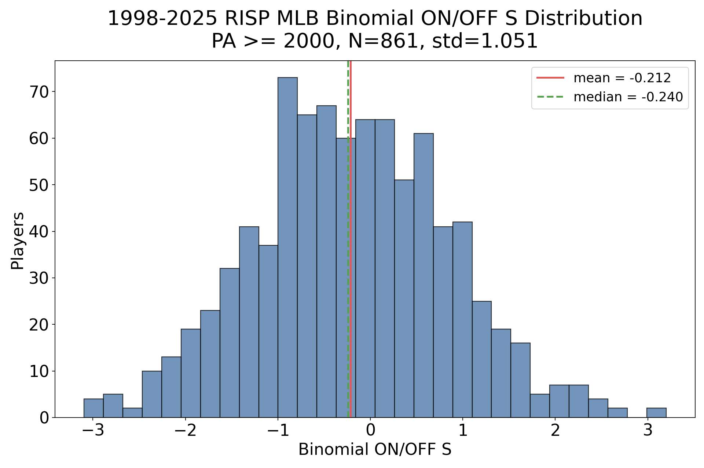
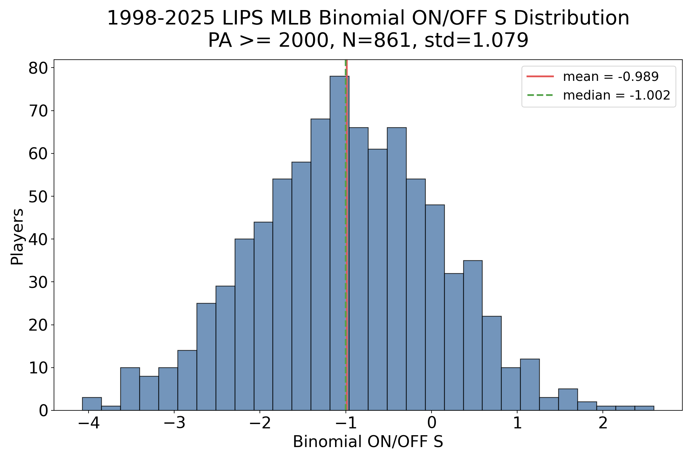

# Baseline Analysis

## Research Motivation

Classic approaches include Cramer’s expected PWA framework and Ruane’s
within-player RISP versus non-RISP comparison. This project adopts the
astrophysical ON/OFF comparison, where the samples can have different
exposures. In baseball, each hitter’s number of eligible trials supplies
the exposure for each situation.

## Situation Definitions

RISP means a runner on second or third before the final pitch. LIPS means
the seventh inning or later with the batting team trailing by up to three
runs, tied, or ahead by one run. It also includes a four-run deficit with
the bases loaded at the start of the plate appearance.

## Event Classification and Sample Selection

Hits are singles, doubles, triples, and home runs. Classified failures
include outs, fielding errors, fielder’s choices, and sacrifice flies.
Walks (including intentional walks), hit-by-pitches, catcher interference,
and sacrifice bunts are excluded from the hit-rate denominator. Sacrifice
flies are included, so this denominator differs from official at-bats.

The primary cutoff is 2,000 total career PA over 1998–2025, with checks at
1,000 and 3,000 PA. Total PA includes excluded events. An ON/OFF score
requires eligible trials in both samples.

## Binomial ON/OFF Statistic

In the summary files, `n` and `b` are ON and OFF plate appearances.
`n_trials` and `b_trials` count eligible outcomes, and `n_rate` and
`b_rate` record the corresponding hit rates. The signed score `S` is
the square root of the two-proportion G statistic in the direction of
the ON-minus-OFF rate difference. Calculating the G statistic separately
for every defined score confirmed agreement with `S²` within `3e-12`
and matching score and rate-difference signs. See the
[mathematical derivation](../methodology/binomial_on_off.md).

## League-Wide Hit Rates

Across all eligible batting trials, the pooled hit rate was 25.28% in
RISP and 25.62% outside RISP. The corresponding LIPS rates were 24.14%
and 25.81%. These are descriptive league rates and reflect differences
in which hitters, pitchers, and game states enter each sample.

## Score Distributions and PA Cutoff Sensitivity

| Career PA cutoff | Hitters | RISP mean S | RISP SD | LIPS mean S | LIPS SD |
|---:|---:|---:|---:|---:|---:|
| 1,000 | 1,343 | −0.163 | 1.054 | −0.895 | 1.079 |
| 2,000 | 861 | −0.212 | 1.051 | −0.989 | 1.079 |
| 3,000 | 595 | −0.250 | 1.060 | −1.092 | 1.108 |





## Interpretation and Limitations

The LIPS mean is lower at every cutoff. Pooled hit rates also show a
larger ON/OFF gap for LIPS. The pooled rates reflect the mix of hitters,
pitchers, and game states. A within-player signed score tests equality
of the two hit probabilities. Claims about repeatable clutch skill
require calibration, accounting for multiple comparisons and league
context, and a repeatability analysis. See [Step 1](01_risp_lips_correlation.md)
for the paired comparison and overlap-aware test.

## Reproduction

Install the dependencies as described in the [README](../../README.md#reproduction).
Run the following from the repository root. The summaries are written to
a scratch directory.

```bash
python Script/build_league_RISP_sample_counts.py --input-glob "Data/Retrosheet/Compact/mlb_*_plate_appearances_compact.csv" --situation risp --output baseline-output/risp.csv
python Script/build_league_RISP_sample_counts.py --input-glob "Data/Retrosheet/Compact/mlb_*_plate_appearances_compact.csv" --situation lips --output baseline-output/lips.csv
python Script/plot_RISP_histogram.py --input baseline-output/risp.csv --min-pa 2000
python Script/plot_RISP_histogram.py --input baseline-output/lips.csv --min-pa 2000
```

To rebuild the compact inputs from Retrosheet's parsed play-by-play files,
download the source archives and run the compact builder.

```bash
python Script/download_retrosheet_csv.py --start-year 1998 --end-year 2025
python Script/build_retrosheet_pa_compact_range.py --start-year 1998 --end-year 2025
```
