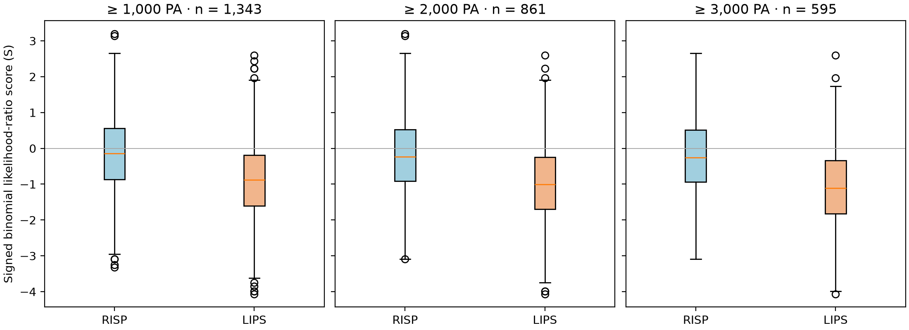
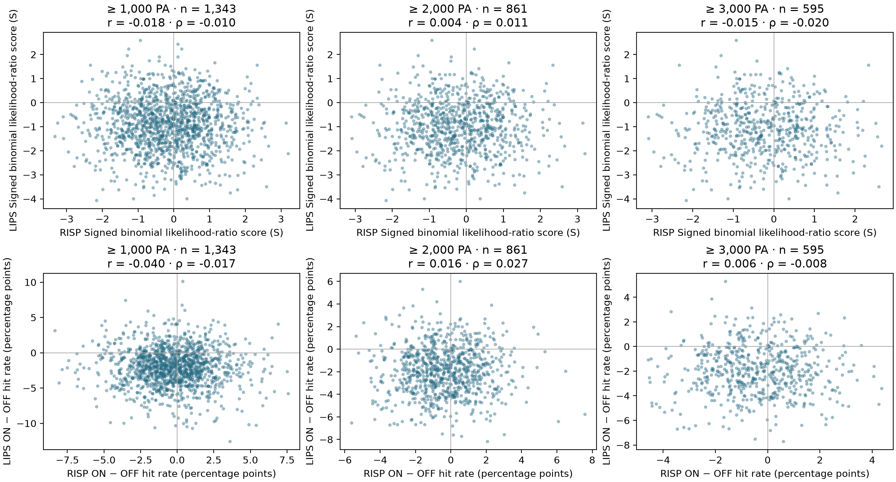
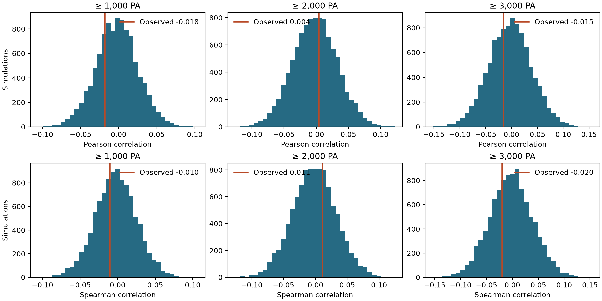

# Step 1 — RISP–LIPS Correlation

## Research Questions

1. How do score distributions and player profiles differ between RISP and LIPS?
2. How closely do hitters’ signed scores and raw hit-rate differences align?
3. Does the observed score correlation exceed what random hit variation and shared plate appearances can explain?

## Exploratory Data Analysis

The [baseline analysis](00_baseline_analysis.md) describes the game-state
definitions, event filtering, and marginal score distributions.

The script joins the marginal summaries one-to-one on Retrosheet batter ID
and checks total PA equality and date coverage. It assigns each PA to one of
four disjoint categories using two Boolean flags: neither, RISP only, LIPS
only, or both. It sums plate appearances, eligible trials, and hits within
each category, then reconstructs both marginal summaries and checks the
observed PA, hits, trials, failures, exclusions, rates, and signed scores.
It independently verifies the squared scores against a 2×2 G statistic.

A trial is a hit or a classified failure. Walks (including intentional
walks), hit-by-pitches, catcher interference and sacrifice bunts are excluded.
Sacrifice flies count as failures, so the hit-rate denominator differs from
official at-bats. The analysis uses paired complete cases. Players without
an eligible trial in one of the ON/OFF groups have an undefined score.

The summaries matched on all 5,716 Retrosheet batter IDs and total PA counts.
Of these, 4,010 had both scores defined. All hitters meeting each of the
three PA thresholds had defined scores for both situations. Aggregating the
four disjoint categories back to RISP and LIPS reproduced the published
marginal counts across 4,569,453 eligible batting trials.

LIPS scores shifted lower at each cutoff. At 2,000 PA, Allen Craig led RISP
(S = 3.198) and Paul DeJong led LIPS (S = 2.592). Casey Blake and Jermaine
Dye had the lowest RISP and LIPS scores, respectively. Freddie Freeman had
the largest RISP-minus-LIPS gap (2.588 versus −3.487). Travis Lee had the
largest gap in the other direction (−2.335 versus 1.557). Full
[distribution statistics](../../Results/RISP_LIPS/descriptive_statistics.csv)
and [extreme results](../../Results/RISP_LIPS/extremes.csv) include the
sensitivity cutoffs.



## Correlation Analysis

The primary sample uses 2,000 total PA. The 1,000 and 3,000 cutoffs are
nested sensitivity samples. All-player and cutoff-specific exclusions are
listed in [sample coverage](../../Results/RISP_LIPS/sample_coverage.csv). Scores quantify evidence for a within-player
difference. Raw hit-rate differences quantify the magnitude. Rates in CSVs
are fractions, and the scatterplot expresses differences in percentage points.

Pearson 95% intervals use Fisher's transformation. Spearman 95% intervals
use the 2.5th and 97.5th percentiles of 2,000 paired player bootstrap
resamples. Conventional two-sided p-values against zero come from SciPy's
[pearsonr](https://docs.scipy.org/doc/scipy/reference/generated/scipy.stats.pearsonr.html)
and [spearmanr](https://docs.scipy.org/doc/scipy/reference/generated/scipy.stats.spearmanr.html).
These intervals and p-values describe the paired-player relationship under
their usual sampling assumptions. The zero null can differ from the
overlap-aware null.

Each tail contains ceil(0.05 × n) players with ties broken by ascending
Retrosheet ID. The extremes table lists five players per tail and metric, and
the five largest signed score gaps in each direction. Score gaps are descriptive
and can reflect different marginal trial counts and league baselines.

The signed score measures evidence for a rate difference, while the raw difference
measures its size. The two sets of coefficients were near zero at all
three cutoffs.

| Career PA cutoff | Hitters | Score Pearson | Score Spearman | Raw difference Pearson | Raw difference Spearman | Score top / bottom overlap |
|---:|---:|---:|---:|---:|---:|---:|
| 1,000 | 1,343 | −0.018 | −0.010 | −0.040 | −0.017 | 2 / 4 (of 68 per tail) |
| 2,000 | 861 | 0.004 | 0.011 | 0.016 | 0.027 | 2 / 4 (of 44 per tail) |
| 3,000 | 595 | −0.015 | −0.020 | 0.006 | −0.008 | 1 / 2 (of 30 per tail) |

For the primary sample, the 95% intervals for Pearson and Spearman score
correlations were [−0.063, 0.071] and [−0.059, 0.076]. Conventional two-sided
p-values against zero were 0.900 and 0.750. The
[correlation table](../../Results/RISP_LIPS/correlations.csv) includes all
intervals and conventional p-values. The [tail overlap table](../../Results/RISP_LIPS/tail_overlap.csv)
also includes the raw rate differences.



## Statistical Hypothesis Testing

For each player, estimate a pooled hit probability from all eligible trials.
In each draw, hold the four trial counts fixed and draw independent category
hit counts with that same player probability. Reconstruct both sets of ON/OFF
counts from the single draw, using the same simulated hits in the
shared categories. Compute Pearson and Spearman correlations of the two
signed score vectors within each PA cutoff. The same simulated populations
are used across the nested samples.

The reported central 95% interval describes the distribution of simulated
correlations. The excess is observed correlation minus mean simulated
correlation. The prespecified one-sided p-value is
`(1 + count(simulated >= observed)) / (1 + simulations)`.

In 10,000 draws, the observed correlations fell inside the central 95%
null intervals at all three cutoffs. The [Monte Carlo results](../../Results/RISP_LIPS/null_summary.csv)
report the observed correlations, null means, intervals, and p-values for
each cutoff.

| Method at 2,000 PA | Observed | Mean under null | Central 95% null interval | Observed minus null mean | One-sided p |
|---|---:|---:|---:|---:|---:|
| Pearson | 0.0043 | −0.0018 | [−0.0687, 0.0659] | 0.0060 | 0.432 |
| Spearman | 0.0109 | −0.0016 | [−0.0685, 0.0671] | 0.0125 | 0.359 |



## Interpretation

RISP defines importance using the base state, while LIPS emphasizes score
and inning. They therefore describe different forms of context-dependent
batting performance. Pearson and Spearman correlations were close to zero
across all three PA thresholds, and the overlap-aware test found no evidence
of positive excess correlation. The scores may provide complementary
information. This motivates a joint likelihood model that estimates
both situational effects simultaneously.

Overlapping observations can contribute covariance in either direction.
For the two raw ON-minus-OFF hit-rate differences, a hit in **both** situations
raises both contrasts. A hit in **neither** raises both OFF rates, lowering
both contrasts. A hit in **RISP only** raises the RISP ON rate and the LIPS OFF
rate, moving the contrasts in opposite directions. **LIPS only** works in
the opposite direction. Under the simulation model, these covariance
contributions are weighted by the category variances and marginal trial
counts, so they can offset one another. The simulation carries that dependence
through the nonlinear transformation to signed scores.

## Limitations

The results do not establish distinct, persistent player abilities or
statistical independence. The null assumes a constant hit probability within
each hitter and omits league-wide situational effects, pitcher quality,
and other game context. Stronger relief pitching in late, close games
could help explain the lower LIPS scores, but this analysis did not test
that hypothesis. The nested cutoffs and two correlation methods use
related observations and should not be treated as independent replications.
The test does not estimate season-to-season repeatability.

## Reproduction

Run from the repository root with the dependencies in `requirements.txt`.

```bash
python Script/analyze_risp_lips.py --simulations 10000 --seed 20251113
python -m unittest discover -s tests
```

Use `--output-dir` to write a run elsewhere. The analysis reads the 28
tracked compact season files and the tracked RISP and LIPS marginal counts.

The project uses runner state before the final pitch for RISP and runner state
at the start of the PA for the bases-loaded LIPS exception. See the
[likelihood derivation](../methodology/binomial_on_off.md) for the signed score.
The [generated results](../../Results/RISP_LIPS/) include the merged dataset,
four-category counts, [sample coverage](../../Results/RISP_LIPS/sample_coverage.csv),
integrity checks, tables, and figures.
