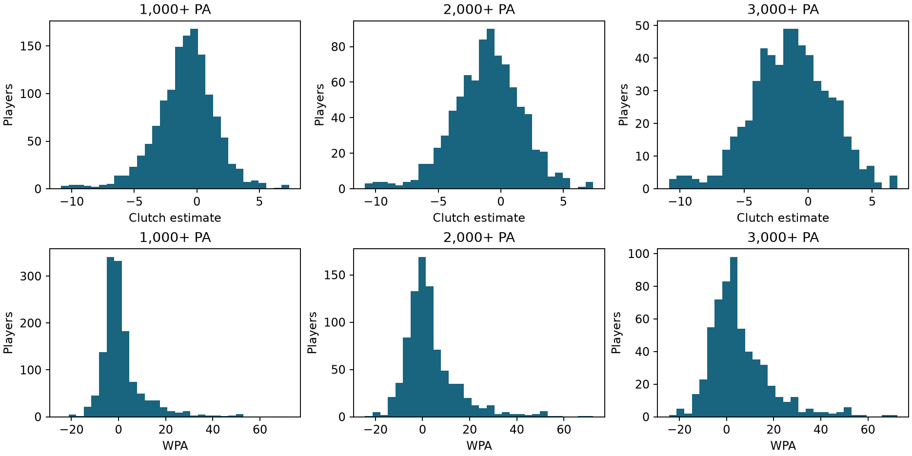
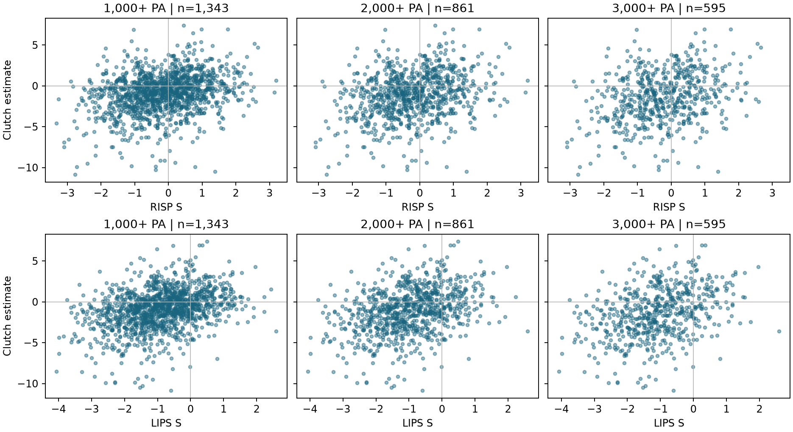
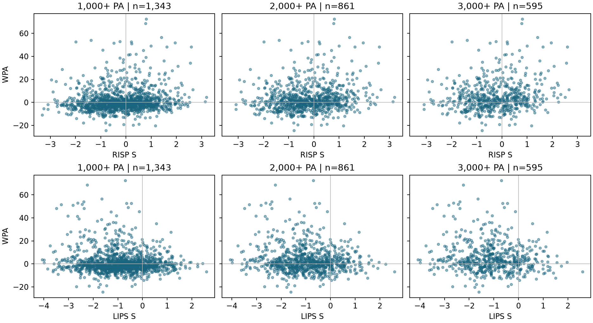
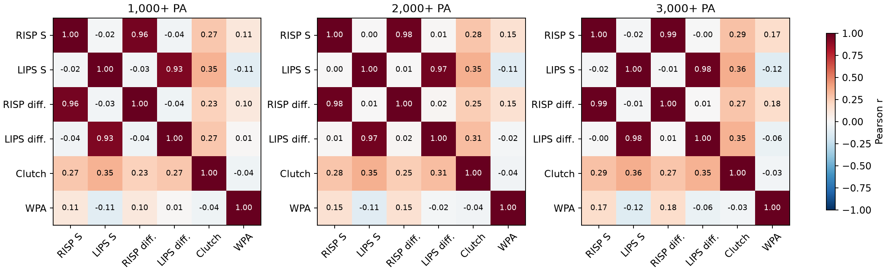
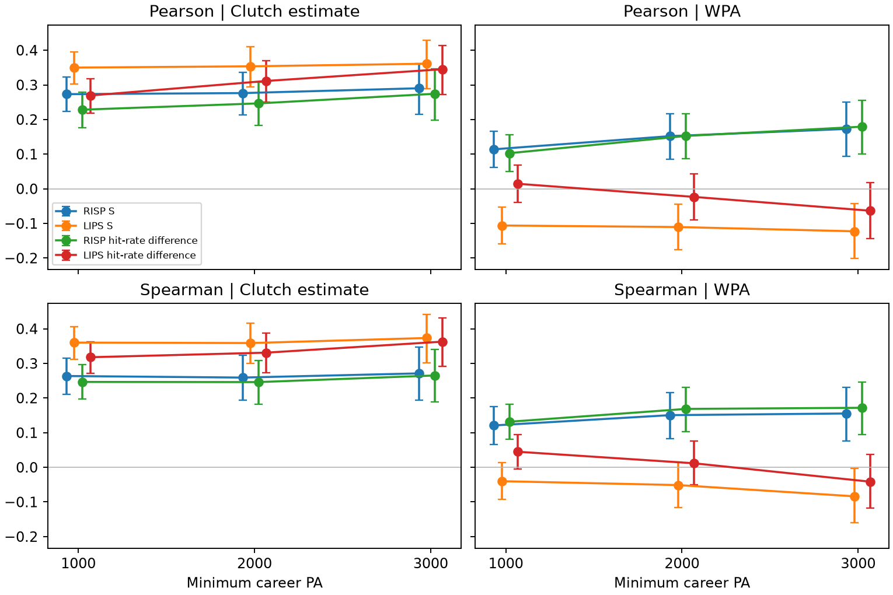

# Step 2 — External Benchmark Analysis

## Data and coverage

This analysis compares the signed RISP and LIPS scores and raw ON-minus-OFF
hit-rate differences with the Baseball-Reference 1998–2025 Clutch estimate
and WPA. All 5,716 Retrosheet batter IDs joined one-to-one with matching
Retrosheet PA totals. The unrestricted sample had 834 missing RISP scores,
1,624 missing LIPS scores, 54 missing Clutch estimates and zero missing WPA.
All six metrics were complete in the three cutoff samples of 1,343, 861,
and 595 hitters. The primary sample had 119 PA discrepancies between
Baseball-Reference and Retrosheet. Cutoffs and PA adjustments use Retrosheet PA.
[Sample coverage](../../Results/External_Benchmark/sample_coverage.csv)

## Distributions and player examples

At 2,000 PA, mean Clutch was −1.11 (SD 2.79, range −10.85 to 7.38).
Mean WPA was 3.53 (SD 11.75, range −24.4 to 72.4), with right skew
of 1.90. The 1.5-IQR rule flagged 20 Clutch and 63 WPA observations.
All were retained. The examples table selects extremes of the product
of the two centered percentile ranks. Adrian Beltré ranked low in both
RISP and Clutch (−2.76 and −10.85). Marcus Semien had a positive RISP
score (1.39) and Clutch of −10.50. Jermaine Dye ranked low in LIPS and
Clutch (−4.07 and −8.53), while Jacoby Ellsbury had LIPS −2.76 and
Clutch 3.72.
[Descriptive statistics](../../Results/External_Benchmark/descriptives.csv) ·
[Player examples](../../Results/External_Benchmark/examples.csv)







## Correlations and primary hypothesis

We prespecified the one-sided comparison of LIPS–Clutch minus RISP–Clutch
at 2,000 PA. Williams' t test accounts for the shared Clutch variable and
the correlation between RISP and LIPS. Its reference distribution has
n − 3 degrees of freedom, with the one-sided p-value taken at equality.
The method relies on the usual multivariate normal approximation. The 95%
intervals for the difference use 10,000 paired player bootstrap draws at
each cutoff with seed 20261114. Each draw retains all of a player's
variables together. Spearman ranks are recomputed in each draw.
[Williams test formula](https://search.r-project.org/CRAN/refmans/cocor/help/cocor.dep.groups.overlap.html)

| Retrosheet cutoff | Method | RISP–Clutch | LIPS–Clutch | Difference | Bootstrap 95% interval | Williams one-sided p |
|---:|---|---:|---:|---:|---|---:|
| 1,000 | Pearson | 0.273 | 0.350 | 0.077 | [0.005, 0.148] | 0.017 |
| 1,000 | Spearman | 0.264 | 0.360 | 0.097 | [0.026, 0.168] | |
| 2,000 | Pearson | 0.276 | 0.354 | 0.077 | [−0.013, 0.167] | 0.041 |
| 2,000 | Spearman | 0.259 | 0.359 | 0.100 | [0.011, 0.188] | |
| 3,000 | Pearson | 0.290 | 0.361 | 0.071 | [−0.038, 0.179] | 0.093 |
| 3,000 | Spearman | 0.271 | 0.373 | 0.102 | [−0.007, 0.209] | |

The prespecified one-sided Pearson test supports a stronger positive LIPS
association at the 5% level (t = 1.741, df = 858). The two-sided Pearson
bootstrap interval includes zero, while the Spearman interval excludes
zero. The direction is consistent across cutoffs. The nested samples are
sensitivity checks and the 3,000 PA Pearson result has p = 0.093.

At 2,000 PA, the raw hit-rate differences also favor LIPS for Clutch
(Pearson 0.311 versus 0.247, Spearman 0.331 versus 0.246). WPA shows a
different pattern. Its Pearson correlations with signed RISP and LIPS
scores are 0.152 and −0.110, and with the raw differences are 0.153 and
−0.023. The individual correlations table reports two-sided p-values,
95% Fisher intervals for Pearson and paired percentile bootstrap
intervals for Spearman. Secondary comparisons are descriptive and
p-values are unadjusted.
[Correlations](../../Results/External_Benchmark/correlations.csv) ·
[Dependent tests](../../Results/External_Benchmark/dependent_tests.csv) ·
[Bootstrap draws](../../Results/External_Benchmark/bootstrap_deltas.csv) ·
[Correlation matrices](../../Results/External_Benchmark/correlation_matrices.csv)





## PA sensitivity

At 2,000 PA, Pearson correlations with total PA were approximately 0.000
for RISP, −0.150 for LIPS, −0.150 for Clutch, and 0.584 for WPA. Partial
Pearson correlations use residuals from separate linear regressions on
log(total PA). Per-600 rates divide the benchmark by Retrosheet PA and
multiply by 600.

| Pearson analysis at 2,000 PA | RISP–Clutch | LIPS–Clutch | RISP–WPA | LIPS–WPA |
|---|---:|---:|---:|---:|
| Unadjusted | 0.276 | 0.354 | 0.152 | −0.110 |
| Control for log(PA) | 0.279 | 0.337 | 0.183 | −0.033 |
| Benchmark per 600 PA | 0.272 | 0.328 | 0.172 | −0.059 |

Both PA sensitivities preserve the LIPS–Clutch ordering and reduce the
Pearson difference from 0.077 to about 0.058 and 0.056. The negative
LIPS–WPA association moves closer to zero. These are descriptive
sensitivity checks. [Full PA sensitivity results](../../Results/External_Benchmark/pa_sensitivity.csv)

## Interpretation and limitations

The two situational scores agree with the external Clutch benchmark to
different degrees. LIPS groups plate appearances by inning and score,
while RISP groups them by runners on base. The ON/OFF scores measure
evidence for a change in hit rate and depend on sample size. The external
benchmark measures a leverage-adjusted contribution to win probability.
It is reconstructed from rounded season statistics, so the period
estimates inherit that rounding. Both sets of measures summarize the
same historical performances. The associations alone establish neither
causation, predictive validity, persistent player ability, nor superiority
of either score. [Baseball-Reference aggregation details](../../Data/BaseballReference/README.md)

## Reproduction

Run from the repository root with the dependencies in requirements.txt.

```bash
python Script/analyze_external_benchmark.py --bootstrap 10000 --seed 20261114
python -m unittest discover -s tests
```
