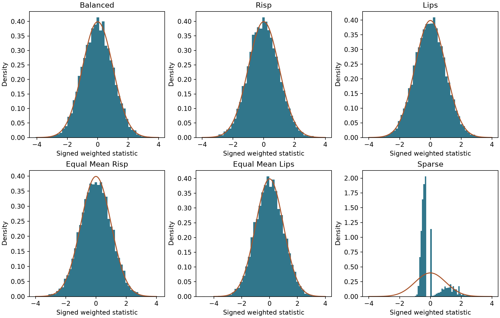
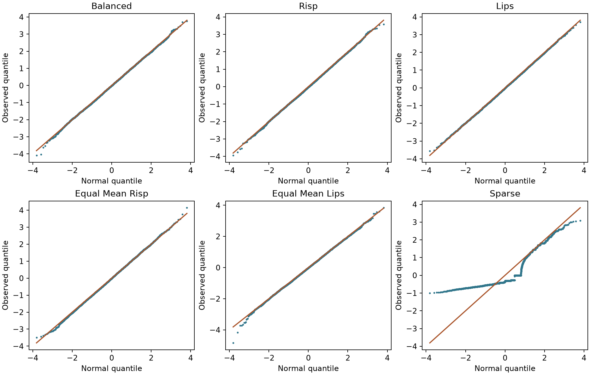

# Step 3.2 — Weighted ON/OFF validation

The weighted likelihood ratio compares weighted production means while
allowing each group its own outcome distribution. See the
[derivation and tolerances](../methodology/multinomial_on_off.md).

## Numerical consistency

With hit weights set to one, the failure weight set to zero, and BB/HBP
excluded, the solver reproduced all defined binomial scores across both
5,716-player files. Undefined results also matched. The largest errors
were 4.42e-10 for RISP (4,882 defined) and 1.91e-8 for LIPS (4,092 defined),
below the absolute tolerance of 2e-7. Unit tests check distinct distributions
with equal means, sign reversal, affine weight invariance, zero counts,
rare outcomes, unequal exposures, and empty samples. A boundary test checks
a known optimum with positive mass in an unobserved category.
[Binomial reduction](../../Results/Weighted_ON_OFF/Validation/binomial_reduction.csv)

## Monte Carlo calibration

Seed 20261114 generated 10,000 independent ON/OFF count pairs per
configuration. The realistic probabilities come from all eligible Step 3.1
Retrosheet trials pooled across both RISP groups. The 1:3 and 1:7 ON/OFF
ratios approximate RISP and LIPS exposures. For the unequal-distribution
null, the ON distribution replaces half its single probability with a
mixture of outs and home runs preserving expected production. The sparse
scenario uses 98.5% zero outcomes and 15 ON trials to stress the boundary
behavior. All 100,000 fits succeeded. The largest fitted null mean gap
on the normalized weight scale was about 4.81e-14.

| Null design | ON/OFF trials | Mean S | SD | Rejection at 5% | Rejection at 1% |
|---|---:|---:|---:|---:|---:|
| Identical, balanced | 300 / 300 | −0.011 | 1.002 | 4.57% | 0.99% |
| Identical, RISP | 500 / 1,500 | −0.022 | 0.996 | 4.80% | 0.98% |
| Identical, LIPS | 250 / 1,750 | −0.020 | 0.993 | 4.71% | 0.91% |
| Equal mean, RISP | 500 / 1,500 | −0.008 | 1.019 | 5.24% | 1.23% |
| Equal mean, LIPS | 250 / 1,750 | −0.015 | 1.004 | 4.94% | 0.92% |
| Sparse | 15 / 135 | −0.054 | 0.741 | 1.63% | 0.33% |

The five realistic scenarios have central 95% endpoints near the normal
reference of ±1.960. Their TS 95th and 99th percentiles range from 3.725
to 3.932 and 6.427 to 6.949, close to the chi-square(1) references of
3.841 and 6.635. The sparse case has a 10.29% point mass at zero,
asymmetric tails, and TS percentiles of 2.641 and 4.718. Consequently
the nominal asymptotic cutoffs are conservative in that scenario.
Calibration depends on the outcome distribution and exposures.
These simulations evaluate independent multinomial trials.
[Simulation summary](../../Results/Weighted_ON_OFF/Validation/simulation_summary.csv) ·
[Generating probabilities](../../Results/Weighted_ON_OFF/Validation/simulation_probabilities.csv) ·
[Optimizer failures](../../Results/Weighted_ON_OFF/Validation/optimizer_failures.csv)





## Power under alternatives

The alternatives move 0.02 or 0.05 probability from ON outs to ON home
runs, producing mean gaps of 0.04 or 0.10. The score uses the observed mean
difference as its sign. A positive population gap yields mostly positive
scores, with occasional negative scores due to sampling variation.

| ON/OFF trials | Mean gap | Positive scores | Power at 5% | Power at 1% |
|---|---:|---:|---:|---:|
| 100 / 300 | 0.04 | 72.88% | 9.81% | 2.62% |
| 100 / 300 | 0.10 | 92.61% | 33.13% | 14.79% |
| 500 / 1,500 | 0.04 | 92.11% | 30.07% | 13.19% |
| 500 / 1,500 | 0.10 | 99.95% | 92.06% | 78.82% |

Power increased with both exposure and effect size in these comparisons.

## Reproduction

```bash
python Script/validate_weighted_on_off.py --simulations 10000
python -m unittest discover -s tests
```
