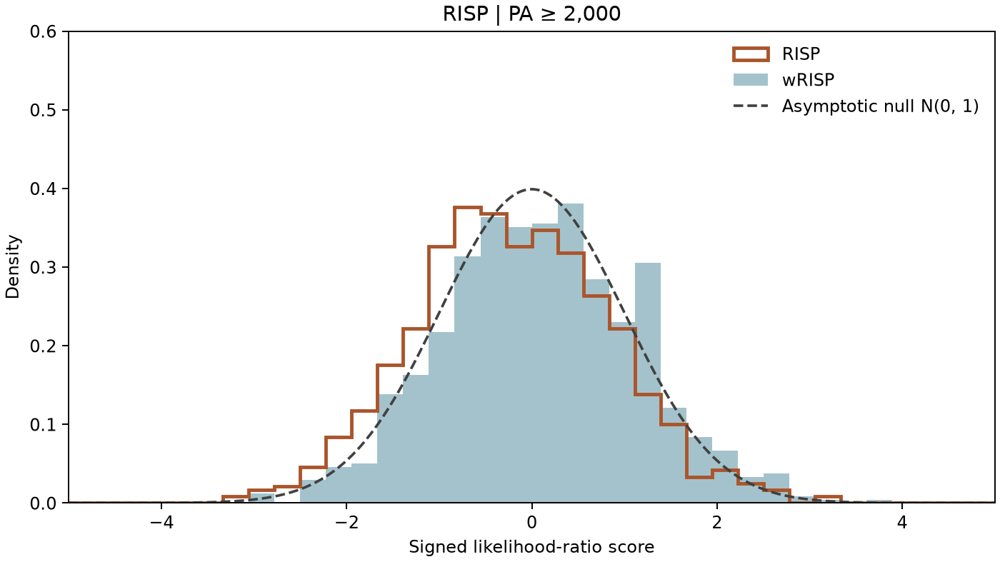
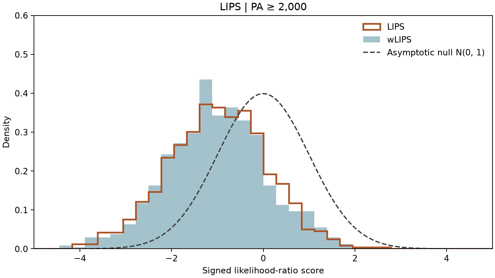
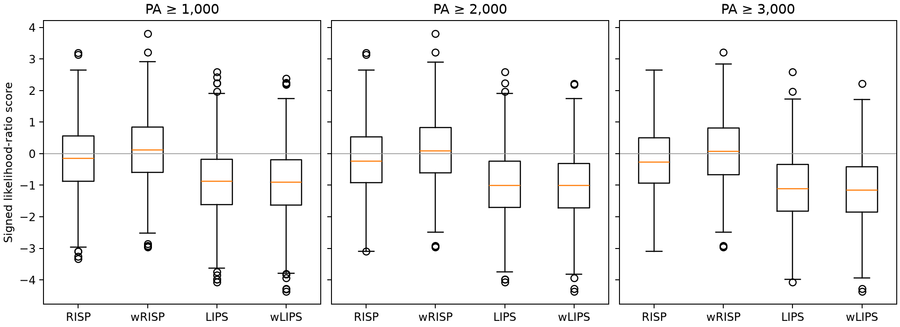

# Step 3.3 — Weighted baseline analysis

## Data and verification

The analysis applies the fixed [Step 3.1 weights](03_weighted_on_off.md)
and [Step 3.2 likelihood ratio](../methodology/multinomial_on_off.md) to
the existing 1998–2025 counts. Both output files retain all 5,716 hitters.
Each player ID and PA total matched the Step 1 data. The seven outcome
counts reproduce eligible trials and, with exclusions, reconcile to the
original ON/OFF totals. Binomial scores are copied from Step 1.

RISP has 4,915 weighted scores and 801 undefined scores. LIPS has 4,113
weighted scores and 1,603 undefined scores. All undefined scores have
an empty eligible group. There were zero optimizer failures. Each
defined score agrees with the weighted mean difference in sign, using
the solver's numerical equality tolerance, and its square matches
the likelihood-ratio statistic. The highest normalized null mean
residual was 8.64e-13. All players at the three PA cutoffs have all
four scores. [Integrity checks](../../Results/Weighted_ON_OFF/Baseline/integrity.csv)

## Pooled production

These are ratios of aggregate counts. Hit rate is hits per original
eligible trial. Weighted production is the sum of weighted outcomes
per expanded eligible trial. The original model uses 4,569,453 trials.
Adding unintentional walks and hit-by-pitches gives 5,019,958 weighted
trials. Both figures apply to each partition.

| Situation | Quantity | ON | OFF | ON − OFF |
|---|---|---:|---:|---:|
| RISP | Hit rate | 0.252780 | 0.256214 | −0.003434 |
| RISP | Weighted production | 0.325164 | 0.322564 | +0.002600 |
| LIPS | Hit rate | 0.241427 | 0.258105 | −0.016678 |
| LIPS | Weighted production | 0.307689 | 0.326316 | −0.018627 |

The two quantities have different units and denominators. The RISP
direction flips, while pooled LIPS production stays lower in the ON
group. [Pooled results and denominators](../../Results/Weighted_ON_OFF/Baseline/league_production.csv)

## Score distributions

Each cell is mean (sample SD) for untransformed scores.

| Minimum PA | Hitters | RISP | wRISP | LIPS | wLIPS |
|---:|---:|---:|---:|---:|---:|
| 1,000 | 1,343 | −0.163 (1.054) | +0.115 (1.055) | −0.895 (1.079) | −0.895 (1.091) |
| 2,000 | 861 | −0.212 (1.051) | +0.102 (1.051) | −0.989 (1.079) | −1.009 (1.083) |
| 3,000 | 595 | −0.250 (1.060) | +0.075 (1.069) | −1.092 (1.108) | −1.123 (1.107) |

The medians follow the mean shifts. Dispersion changes little and absolute
skewness stays below 0.09 at all three cutoffs. At 2,000 PA, the RISP
5th–95th percentile range shifts from [−1.915, 1.518] to [−1.575, 1.812].
For LIPS it moves from [−2.792, 0.719] to [−2.729, 0.882], even as its mean
declines slightly. The negative LIPS mean persists at every cutoff.
The displayed normal reference is the asymptotic null for an individual
test under its assumptions. These distributions contain observed player
performances, whose underlying situational production may differ.
[Full score summaries](../../Results/Weighted_ON_OFF/Baseline/score_summary.csv) ·
[Step 3.2 null calibration](03_2_weighted_validation.md)





[Weighted RISP histogram](../../Results/Weighted_ON_OFF/Baseline/figures/wrisp_histogram.png) ·
[Weighted LIPS histogram](../../Results/Weighted_ON_OFF/Baseline/figures/wlips_histogram.png)



## Player rankings and score changes

The rankings give the ten highest and ten lowest weighted scores for
each situation and cutoff, with ties ordered by batter ID. The changes
table selects the five largest increases and decreases per situation at
2,000 PA. Each contribution is the fixed weight times the ON-minus-OFF
difference in outcome frequency on the expanded denominator.

| Player | Situation | Binomial → weighted score | Largest contributions to weighted gap |
|---|---|---|---|
| Damian Miller | RISP | −2.153 → +0.013 | More walks (+0.0424) offset fewer singles (−0.0418), with other outcomes leaving a gap of +0.00025 |
| David Ortiz | RISP | +0.222 → −1.200 | Fewer home runs (−0.0323) outweighed more singles (+0.0149) |
| Anthony Santander | LIPS | −1.971 → −0.648 | More home runs (+0.0242) partially offset fewer singles (−0.0422) and doubles (−0.0082) |
| Carlos González | LIPS | −1.207 → −2.950 | Fewer home runs (−0.0348), walks (−0.0193) and doubles (−0.0168) outweighed more singles (+0.0231) |

These contributions explain the observed weighted production differences.
The change in score also reflects the expanded trial definition and the
different likelihood. Individual outcomes are descriptive evidence for
this period and do not establish persistent player ability.
[Rankings](../../Results/Weighted_ON_OFF/Baseline/rankings.csv) ·
[Score changes and contributions](../../Results/Weighted_ON_OFF/Baseline/score_changes.csv)

## Reproduction

```bash
python Script/analyze_weighted_baseline.py
python -m unittest discover -s tests
```

[RISP player file](../../Results/Weighted_ON_OFF/Baseline/risp_players.csv) ·
[LIPS player file](../../Results/Weighted_ON_OFF/Baseline/lips_players.csv)
