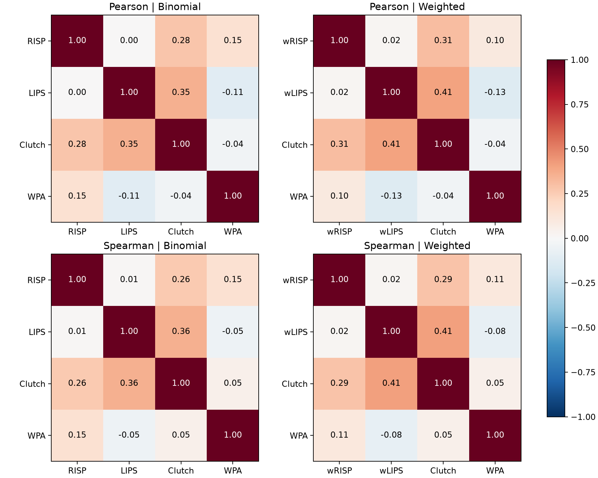
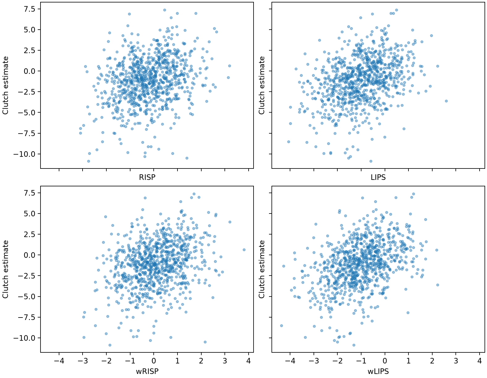
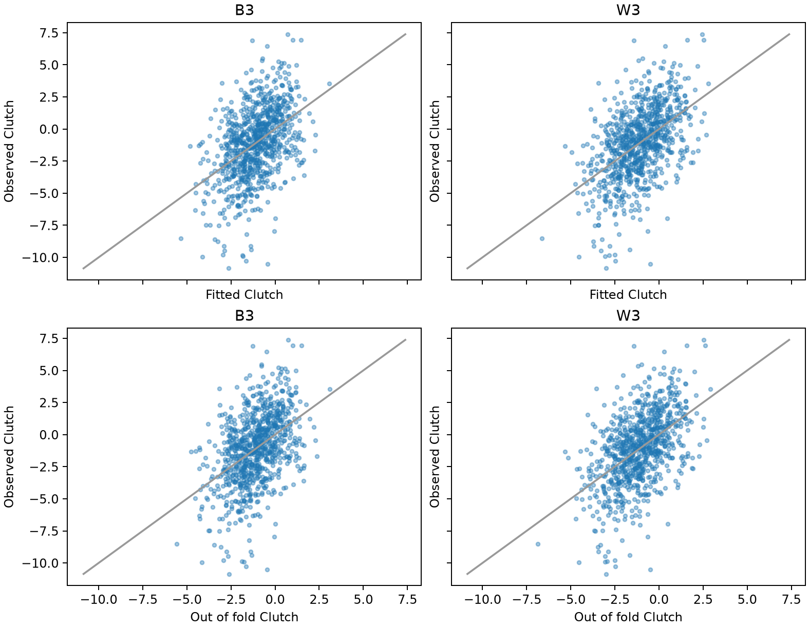
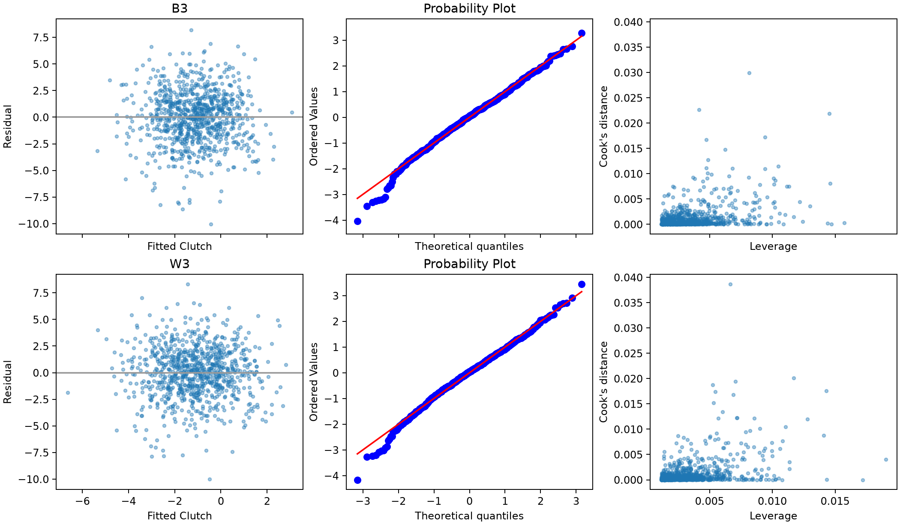
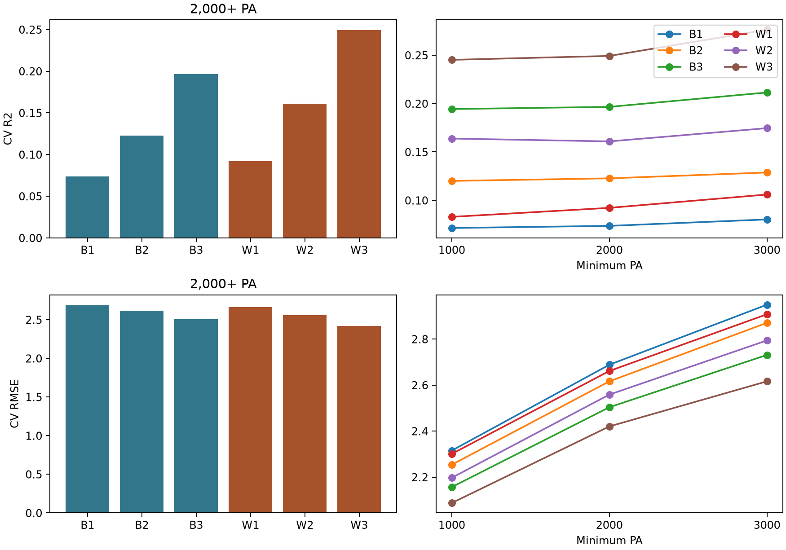

# Step 3.4 — Weighted external benchmark and regression

The analysis joins all 5,716 hitters by Retrosheet batter ID and verifies
the Baseball-Reference IDs, career PA and original signed scores. The
1,000, 2,000 and 3,000 PA samples contain 1,343, 861 and 595 complete
players. Each player's regenerated fold matches Step 2 using the same
sorted order, NumPy seed 20261114, and five shuffled folds. Original
fitted and out-of-fold predictions match Step 2 within 1e-10.

## Correlations

At 2,000 PA the Pearson correlations with Clutch rose from 0.276 to
0.308 for RISP and from 0.354 to 0.405 for LIPS. The gains and their
95% paired percentile intervals were 0.032 [0.001, 0.062] and
0.052 [0.026, 0.077]. Spearman gains were 0.030 [−0.004, 0.062] and
0.054 [0.027, 0.081]. The wRISP gain is less certain for ranks.

Pearson correlation between wRISP and wLIPS was 0.016 at 2,000 PA,
compared with 0.004 for their binomial counterparts. Weighted
Pearson and Spearman correlations between the two situations stayed
below 0.025 at every cutoff. At 2,000 PA, original and weighted versions
of RISP correlated at 0.890 and versions of LIPS at 0.908. The weighted
scores correlated with WPA at 0.101 for RISP and −0.131 for LIPS.
Raw hit-rate differences correlated with Clutch at 0.247 and 0.311,
and raw weighted production differences at 0.282 and 0.377.

| Clutch Pearson at 2,000 PA | RISP | LIPS | wRISP | wLIPS |
|---|---:|---:|---:|---:|
| Unadjusted | 0.276 | 0.354 | 0.308 | 0.405 |
| Control for log(PA) | 0.279 | 0.337 | 0.313 | 0.387 |
| Clutch per 600 PA | 0.272 | 0.328 | 0.296 | 0.373 |

PA sensitivity uses Retrosheet PA. Partial Pearson correlates
residuals from regressions on log(PA). Both adjustments retain
the weighted correlations' advantage in this sample.
[Correlations](../../Results/Weighted_ON_OFF/External_Benchmark/correlations.csv) ·
[Matrices](../../Results/Weighted_ON_OFF/External_Benchmark/correlation_matrices.csv) ·
[PA sensitivity](../../Results/Weighted_ON_OFF/External_Benchmark/pa_sensitivity.csv)





## Regression and cross-validation

Each model is OLS with an intercept and the indicated signed scores as
predictors. HC3 t inference uses residual degrees of freedom. Standardized
slopes multiply the original slope by predictor SD and divide by Clutch
SD. A one-restriction HC3 Wald F test evaluates added predictors within
each family. In the primary W3 fit the intercept is −0.152 and slopes are
0.801 for wRISP (p = 3.82e-19) and 1.033 for wLIPS (p = 1.36e-35).
Adding wRISP to W2 increases fitted R² by 0.091. Adding wLIPS to W1
increases it by 0.160.

All models share the same held-out players in each fold. Pooled
out-of-fold R² uses the overall observed mean as the reference.
Bootstrap intervals use 10,000 draws per cutoff and resample matched
player rows with replacement. Rank correlations are recomputed per
draw. For CV differences, each draw keeps the observed value and
both predictions together. These intervals are conditional on the
fixed out-of-fold predictions and omit retraining variability.
[Coefficients](../../Results/Weighted_ON_OFF/External_Benchmark/coefficients.csv) ·
[Nested comparisons](../../Results/Weighted_ON_OFF/External_Benchmark/nested_comparisons.csv) ·
[Fold results](../../Results/Weighted_ON_OFF/External_Benchmark/cv_folds.csv) ·
[Predictions and fold assignments](../../Results/Weighted_ON_OFF/External_Benchmark/predictions.csv) ·
[Bootstrap comparisons](../../Results/Weighted_ON_OFF/External_Benchmark/bootstrap_comparisons.csv)

### At least 1,000 PA

| Model | In-sample Pearson r | In-sample R² | CV Pearson r | CV R² | CV RMSE | CV MAE |
|---|---:|---:|---:|---:|---:|---:|
| RISP | 0.273 | 0.075 | 0.267 | 0.071 | 2.315 | 1.745 |
| LIPS | 0.350 | 0.122 | 0.347 | 0.120 | 2.254 | 1.697 |
| RISP + LIPS | 0.448 | 0.201 | 0.441 | 0.194 | 2.157 | 1.627 |
| wRISP | 0.295 | 0.087 | 0.288 | 0.083 | 2.301 | 1.736 |
| wLIPS | 0.406 | 0.165 | 0.405 | 0.164 | 2.197 | 1.645 |
| wRISP + wLIPS | 0.501 | 0.251 | 0.495 | 0.245 | 2.087 | 1.564 |

### At least 2,000 PA

| Model | In-sample Pearson r | In-sample R² | CV Pearson r | CV R² | CV RMSE | CV MAE |
|---|---:|---:|---:|---:|---:|---:|
| RISP | 0.276 | 0.076 | 0.271 | 0.074 | 2.689 | 2.097 |
| LIPS | 0.354 | 0.125 | 0.350 | 0.123 | 2.616 | 2.034 |
| RISP + LIPS | 0.448 | 0.201 | 0.443 | 0.197 | 2.504 | 1.946 |
| wRISP | 0.308 | 0.095 | 0.304 | 0.092 | 2.661 | 2.071 |
| wLIPS | 0.405 | 0.164 | 0.401 | 0.161 | 2.559 | 1.981 |
| wRISP + wLIPS | 0.505 | 0.255 | 0.499 | 0.249 | 2.420 | 1.875 |

### At least 3,000 PA

| Model | In-sample Pearson r | In-sample R² | CV Pearson r | CV R² | CV RMSE | CV MAE |
|---|---:|---:|---:|---:|---:|---:|
| RISP | 0.290 | 0.084 | 0.283 | 0.080 | 2.950 | 2.341 |
| LIPS | 0.361 | 0.130 | 0.359 | 0.129 | 2.871 | 2.259 |
| RISP + LIPS | 0.467 | 0.218 | 0.460 | 0.211 | 2.731 | 2.152 |
| wRISP | 0.332 | 0.110 | 0.326 | 0.106 | 2.908 | 2.306 |
| wLIPS | 0.420 | 0.176 | 0.418 | 0.175 | 2.794 | 2.192 |
| wRISP + wLIPS | 0.531 | 0.282 | 0.526 | 0.276 | 2.616 | 2.050 |

At 2,000 PA, W3 increased CV R² by 0.0526 (26.8% relative to B3),
with 95% interval [0.0277, 0.0775]. CV RMSE fell by 0.0834 (3.33%),
interval [0.0429, 0.1245], and MAE fell by 0.0713 (3.67%),
interval [0.0324, 0.1107]. CV Spearman correlation increased from 0.448
to 0.500. W3 led its single-score counterparts and B3 at each cutoff.
About 75% of Clutch variation remains unexplained at the primary cutoff.
The percentage improvements in typical errors are modest relative to
the gain expressed as a percentage of the baseline R².







The diagnostic panels show residuals across fitted values, normal Q–Q
plots and Cook's distances. All observations are retained.
[Player diagnostics](../../Results/Weighted_ON_OFF/External_Benchmark/diagnostics.csv)

Clutch is an external benchmark reconstructed from rounded season
statistics. The weighted framework adds BB and HBP to its eligible
trials and assigns different values to hits. Both changes can affect
the result. Cross-validation measures approximation of historical
Clutch for held-out players from the same period. Future performance
and persistence require separate evidence.

## Reproduction

```bash
python Script/analyze_weighted_benchmark.py --bootstrap 10000
python -m unittest discover -s tests
```
