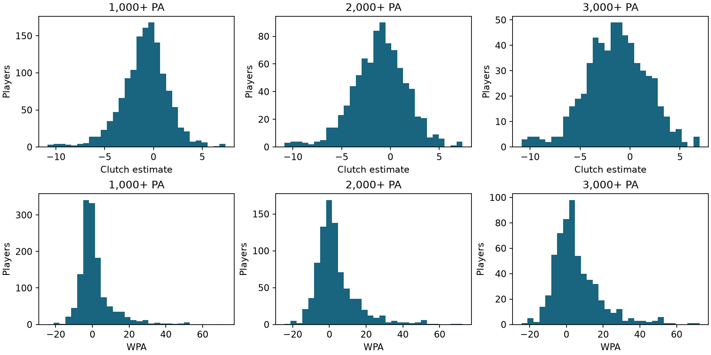
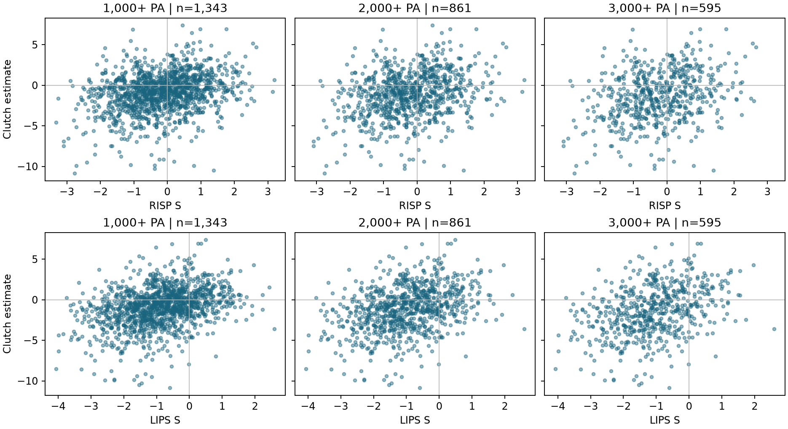
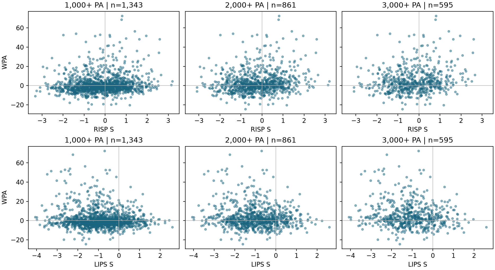
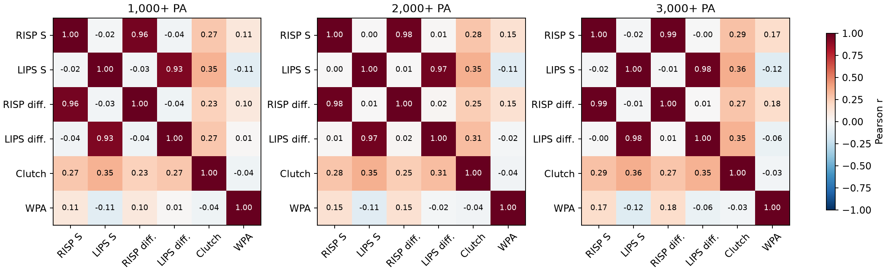
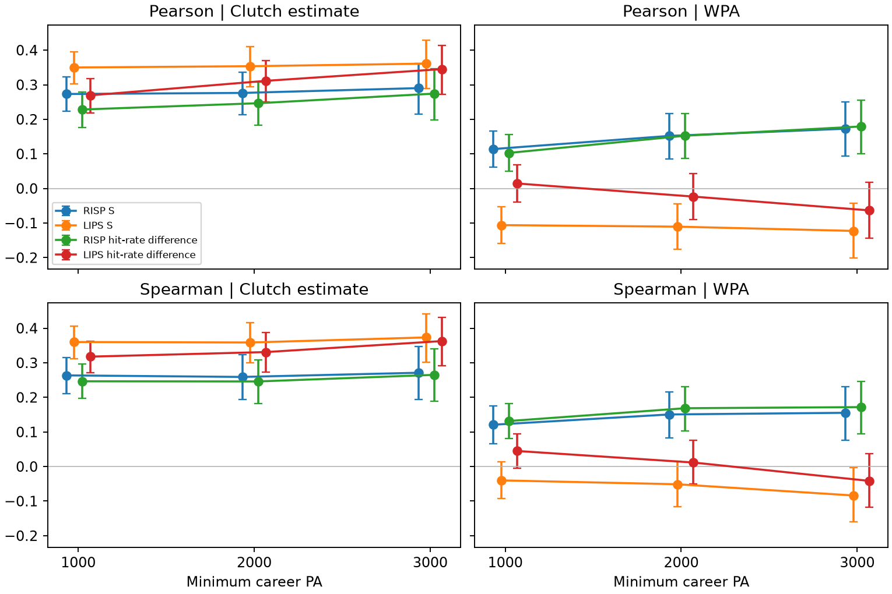
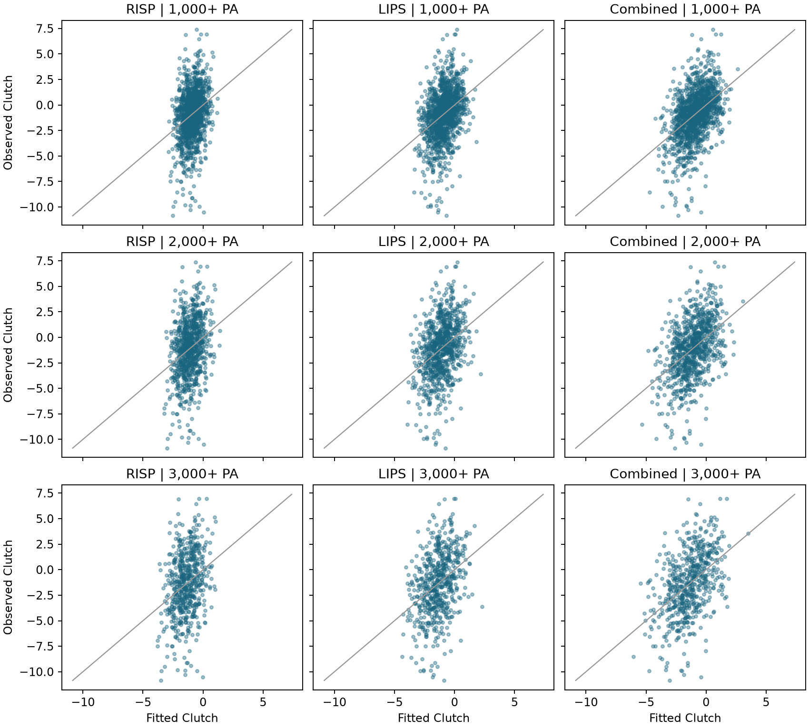
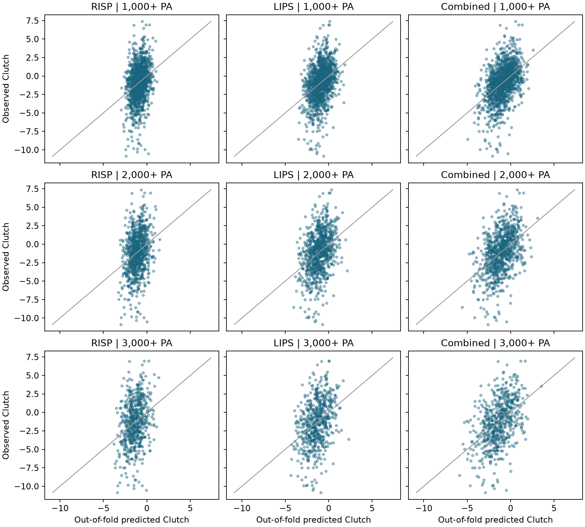
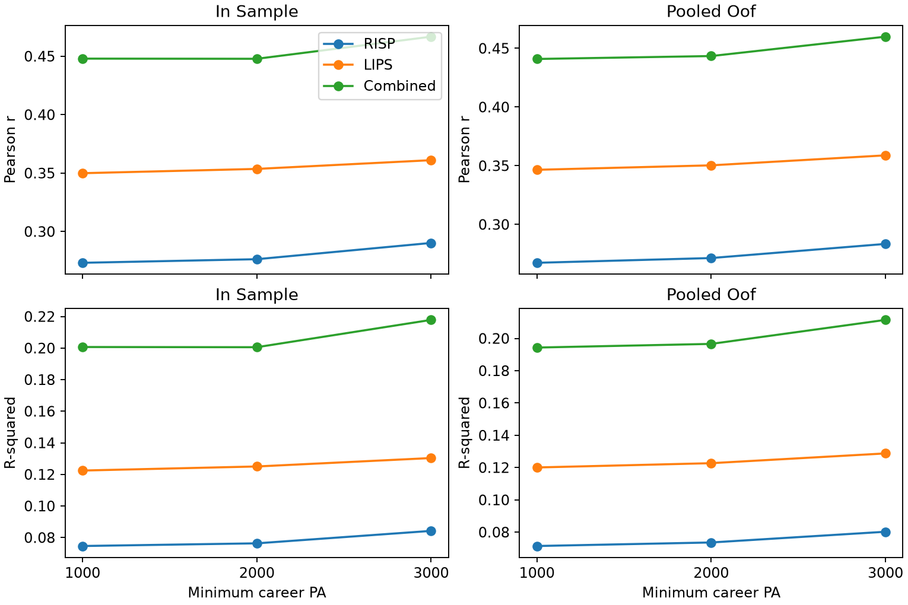
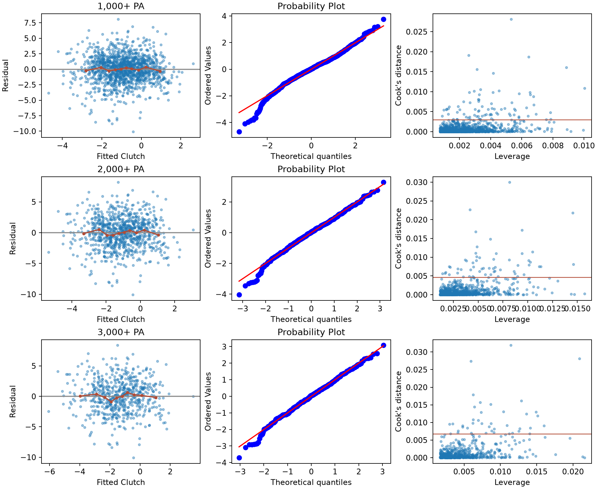

# Step 3 — External Benchmark Analysis

## Data and coverage

This analysis compares the signed RISP and LIPS scores and raw ON-minus-OFF
hit-rate differences with the Baseball-Reference 1998–2025 Clutch estimate
and WPA. All 5,716 Retrosheet batter IDs joined one-to-one with matching
Retrosheet PA totals. The unrestricted sample had 834 missing RISP scores,
1,624 missing LIPS scores, 54 missing Clutch estimates and zero missing WPA.
All six metrics were complete in the three cutoff samples of 1,343, 861,
and 595 hitters. The primary sample had 119 PA discrepancies between
Baseball-Reference and Retrosheet. Cutoffs and PA adjustments use Retrosheet PA.
[Sample coverage](../../Results/External_Benchmark/sample_coverage.csv)

## Distributions and player examples

At 2,000 PA, mean Clutch was −1.11 (SD 2.79, range −10.85 to 7.38).
Mean WPA was 3.53 (SD 11.75, range −24.4 to 72.4), with right skew
of 1.90. The 1.5-IQR rule flagged 20 Clutch and 63 WPA observations.
All were retained. The examples table selects extremes of the product
of the two centered percentile ranks. Adrian Beltré ranked low in both
RISP and Clutch (−2.76 and −10.85). Marcus Semien had a positive RISP
score (1.39) and Clutch of −10.50. Jermaine Dye ranked low in LIPS and
Clutch (−4.07 and −8.53), while Jacoby Ellsbury had LIPS −2.76 and
Clutch 3.72.
[Descriptive statistics](../../Results/External_Benchmark/descriptives.csv) ·
[Player examples](../../Results/External_Benchmark/examples.csv)







## Correlations and primary hypothesis

We prespecified the one-sided comparison of LIPS–Clutch minus RISP–Clutch
at 2,000 PA. Williams' t test accounts for the shared Clutch variable and
the correlation between RISP and LIPS. Its reference distribution has
n − 3 degrees of freedom, with the one-sided p-value taken at equality.
The method relies on the usual multivariate normal approximation. The 95%
intervals for the difference use 10,000 paired player bootstrap draws at
each cutoff with seed 20261114. Each draw retains all of a player's
variables together. Spearman ranks are recomputed in each draw.
[Williams test formula](https://search.r-project.org/CRAN/refmans/cocor/help/cocor.dep.groups.overlap.html)

| Retrosheet cutoff | Method | RISP–Clutch | LIPS–Clutch | Difference | Bootstrap 95% interval | Williams one-sided p |
|---:|---|---:|---:|---:|---|---:|
| 1,000 | Pearson | 0.273 | 0.350 | 0.077 | [0.005, 0.148] | 0.017 |
| 1,000 | Spearman | 0.264 | 0.360 | 0.097 | [0.026, 0.168] | |
| 2,000 | Pearson | 0.276 | 0.354 | 0.077 | [−0.013, 0.167] | 0.041 |
| 2,000 | Spearman | 0.259 | 0.359 | 0.100 | [0.011, 0.188] | |
| 3,000 | Pearson | 0.290 | 0.361 | 0.071 | [−0.038, 0.179] | 0.093 |
| 3,000 | Spearman | 0.271 | 0.373 | 0.102 | [−0.007, 0.209] | |

The prespecified one-sided Pearson test supports a stronger positive LIPS
association at the 5% level (t = 1.741, df = 858). The two-sided Pearson
bootstrap interval includes zero, while the Spearman interval excludes
zero. The direction is consistent across cutoffs. The nested samples are
sensitivity checks and the 3,000 PA Pearson result has p = 0.093.

At 2,000 PA, the raw hit-rate differences also favor LIPS for Clutch
(Pearson 0.311 versus 0.247, Spearman 0.331 versus 0.246). WPA shows a
different pattern. Its Pearson correlations with signed RISP and LIPS
scores are 0.152 and −0.110, and with the raw differences are 0.153 and
−0.023. The individual correlations table reports two-sided p-values,
95% Fisher intervals for Pearson and paired percentile bootstrap
intervals for Spearman. Secondary comparisons are descriptive and
p-values are unadjusted.
[Correlations](../../Results/External_Benchmark/correlations.csv) ·
[Dependent tests](../../Results/External_Benchmark/dependent_tests.csv) ·
[Bootstrap draws](../../Results/External_Benchmark/bootstrap_deltas.csv) ·
[Correlation matrices](../../Results/External_Benchmark/correlation_matrices.csv)





## PA sensitivity

At 2,000 PA, Pearson correlations with total PA were approximately 0.000
for RISP, −0.150 for LIPS, −0.150 for Clutch, and 0.584 for WPA. Partial
Pearson correlations use residuals from separate linear regressions on
log(total PA). Per-600 rates divide the benchmark by Retrosheet PA and
multiply by 600.

| Pearson analysis at 2,000 PA | RISP–Clutch | LIPS–Clutch | RISP–WPA | LIPS–WPA |
|---|---:|---:|---:|---:|
| Unadjusted | 0.276 | 0.354 | 0.152 | −0.110 |
| Control for log(PA) | 0.279 | 0.337 | 0.183 | −0.033 |
| Benchmark per 600 PA | 0.272 | 0.328 | 0.172 | −0.059 |

Both PA sensitivities preserve the LIPS–Clutch ordering and reduce the
Pearson difference from 0.077 to about 0.058 and 0.056. The negative
LIPS–WPA association moves closer to zero. These are descriptive
sensitivity checks. [Full PA sensitivity results](../../Results/External_Benchmark/pa_sensitivity.csv)

## Interpretation and limitations

The two situational scores agree with the external Clutch benchmark to
different degrees. LIPS groups plate appearances by inning and score,
while RISP groups them by runners on base. The ON/OFF scores measure
evidence for a change in hit rate and depend on sample size. The external
benchmark measures a leverage-adjusted contribution to win probability.
It is reconstructed from rounded season statistics, so the period
estimates inherit that rounding. Both sets of measures summarize the
same historical performances. The associations alone establish neither
causation, predictive validity, persistent player ability, nor superiority
of either score. [Baseball-Reference aggregation details](../../Data/BaseballReference/README.md)

## Reproduction

Run from the repository root with the dependencies in requirements.txt.

```bash
python Script/analyze_external_benchmark.py --bootstrap 10000 --seed 20261114
python -m unittest discover -s tests
```

## Regression extension

### Models and evaluation

Fit intercept-bearing OLS models for the reconstructed Baseball-Reference
Clutch target with RISP alone, LIPS alone, and both signed scores. Use the
same complete samples of 1,343, 861, and 595 hitters as above. Standardized
slopes are the fitted slopes multiplied by the predictor SD and divided by
the target SD. Coefficient tests and 95% intervals use HC3 standard errors
and a t reference with residual degrees of freedom. The nested comparisons
test the added slope using its squared HC3 t statistic as a one-restriction
Wald F statistic and report the change in R².
[HC3 covariance definition](https://www.statsmodels.org/stable/generated/statsmodels.stats.sandwich_covariance.cov_hc3.html)

At each cutoff, sort by batter ID and shuffle players using NumPy's default
random generator with seed 20261114. Split that permutation into five
near-equal folds. All three models share the splits and each held-out
prediction uses coefficients fitted on the other four folds. Pooled
out-of-fold R² uses the overall held-out outcomes' mean as its reference.
Fold R² uses each fold's own outcome mean. The fold mean and sample SD
describe variation across folds.

### Primary sample results

| Model | Intercept | RISP slope | LIPS slope | In-sample Pearson | In-sample R² | OOF Pearson | OOF Spearman | OOF R² | OOF RMSE | OOF MAE |
|---|---:|---:|---:|---:|---:|---:|---:|---:|---:|---:|
| RISP | −0.956 | 0.735 | | 0.276 | 0.076 | 0.271 | 0.254 | 0.074 | 2.689 | 2.097 |
| LIPS | −0.206 | | 0.916 | 0.354 | 0.125 | 0.350 | 0.356 | 0.123 | 2.616 | 2.034 |
| Combined | −0.054 | 0.731 | 0.913 | 0.448 | 0.201 | 0.443 | 0.448 | 0.197 | 2.504 | 1.946 |

The combined standardized slopes are 0.275 for RISP and 0.352 for LIPS.
Both added slopes contribute conditional information about Clutch.
Adding RISP to LIPS increases in-sample R² by 0.076 (HC3 Wald F = 68.59,
p = 4.63 × 10⁻¹⁶). Adding LIPS to RISP increases it by 0.124 (F = 128.86,
p = 6.37 × 10⁻²⁸). The correlation identity in the specification gives
R² = 0.2005358641 using unrounded observed correlations. The fitted R²
agrees within 5 × 10⁻¹⁶ across the three cutoffs.

| Primary-sample improvement vs. | In-sample Pearson gain | In-sample R² gain | OOF Pearson gain | OOF R² gain |
|---|---:|---:|---:|---:|
| RISP only | +0.171 (62.1%) | +0.124 (162.6%) | +0.172 (63.4%) | +0.123 (167.1%) |
| LIPS only | +0.094 (26.7%) | +0.076 (60.4%) | +0.093 (26.6%) | +0.074 (60.2%) |

The combined model also leads both single-score fits at the alternate
cutoffs. Its pooled R² is 0.194 at 1,000 PA and 0.211 at 3,000 PA.
[Coefficients](../../Results/External_Benchmark/Regression/coefficients.csv) ·
[Performance and fold summaries](../../Results/External_Benchmark/Regression/performance.csv) ·
[Individual folds](../../Results/External_Benchmark/Regression/cv_folds.csv) ·
[Nested comparisons](../../Results/External_Benchmark/Regression/nested_comparisons.csv) ·
[R² identity](../../Results/External_Benchmark/Regression/analytical_verification.csv) ·
[Player predictions](../../Results/External_Benchmark/Regression/predictions.csv)







### Diagnostics and interpretation

The combined model's Koenker test against variance related to the two
predictors gives p = 0.019 at 1,000 PA and p = 0.612 and 0.680 at the
higher cutoffs. At 2,000 PA, mean residuals across fitted-value deciles
range from −0.399 to 0.517. The 3,000 PA sample has a wider decile mean
range of −0.864 to 0.614, suggesting some calibration variation across
the fitted range. At 2,000 PA, 56 hitters exceed the descriptive Cook's
distance threshold 4/n. Adrián Beltré has the largest distance (0.030).
All observations are retained.
[Diagnostic summary](../../Results/External_Benchmark/Regression/diagnostic_summary.csv) ·
[Player diagnostics](../../Results/External_Benchmark/Regression/diagnostics.csv)



Two situational hit-rate scores give a moderate positive association
with the reconstructed Clutch target without using WPA or leverage as
predictors. The model explains about 20% of the variation in observed
Clutch and leaves about 80% unexplained. This is a supervised approximation
to a target reconstructed from rounded season-level statistics. Its scope
is held-out players' historical Clutch in the same period. Future performance,
persistent clutch ability and statistical significance calibration require
different evidence.

```bash
python Script/analyze_clutch_regression.py
python -m unittest discover -s tests
```

## Dependence on overall batting performance

A player can generate substantial WPA through strong batting across
situations. The ON/OFF scores instead compare each player's batting
with their own OFF-situation baseline. This extension examines how
much association with overall batting remains in those scores and
in the Baseball-Reference period Clutch estimate.

### Data and analysis

The overall eligible hit rate pools hits and eligible trials across
ON and OFF. The overall weighted production pools all seven outcome
counts, multiplies them by the fixed weights, and divides by total
weighted-eligible PA. These denominators follow the existing binomial
and [Appendix A.1](appendix_a_1_weighted_on_off.md) eligibility rules.

OPS+ uses the displayed Baseball-Reference season totals. wRC+ uses
the FanGraphs single-season leaderboard for each of the same 28 MLB
regular seasons (1998–2025). FanGraphs required membership for the
combined 28-season request. Each period estimate weights the season
index by the PA from that source and divides by its summed PA.
These approximations can differ from indexes calculated directly for
the full period. Baseball-Reference OPS+ also inherits published
rounding. The Chadwick mappings join both sources by player ID and
the Retrosheet season extracts verify which seasons are expected.
[OPS+ source and preparation](../../Data/BaseballReference/README.md#step-3-extension--ops) ·
[wRC+ source and preparation](../../Data/FanGraphs/README.md#step-3-extension--wrc)

| Minimum Retrosheet PA | Candidates | Common complete cases | OPS+ PA differences | wRC+ PA differences |
|---:|---:|---:|---:|---:|
| 1,000 | 1,343 | 1,342 | 144 | 153 |
| 2,000 | 861 | 861 | 119 | 126 |
| 3,000 | 595 | 595 | 96 | 103 |

One player, Joey Gathright, has a blank published OPS+ in his
one-PA 2011 season. He is excluded from all comparisons at 1,000 PA.
All other players in the cutoff samples have full coverage for both
indexes. Difference counts use the candidate samples, including
Gathright. At 2,000 PA source-minus-Retrosheet PA ranges from 0 to
13 for OPS+ and −1 to 13 for wRC+. Retrosheet PA defines the cutoffs,
log(PA) control, and per-600 scaling. Across all 5,716 players, 5,535
have a complete OPS+ estimate and 5,716 have a complete wRC+ estimate.
The primary sample correlation between the two indexes is Pearson
0.995 and Spearman 0.994. The indexes summarize closely related
overall performance in this sample.

We use identical complete cases for every correlation and sensitivity
analysis at each cutoff. For partial Pearson correlations, we regress
both variables on log(Retrosheet PA) with an intercept, then correlate
the residuals. Sensitivities also use WPA and Clutch per 600 PA and raw
ON-minus-OFF hit rates and weighted production. The signed scores keep
their original scale. Per-600 rates and raw differences also have
partial Pearson and rank results in the correlation file.

Each of 10,000 paired bootstrap draws resamples player rows with
replacement at the cutoff (seed 20261114). Ranks and PA adjustments
are recalculated inside each draw. Correlation intervals are nominal
95% percentile intervals. For each contrast the bootstrap estimates
|r(benchmark, overall)| minus |r(ON/OFF, overall)|. The primary
family comprises the 16 Pearson contrasts against Clutch at 2,000 PA
(four signed scores by four overall metrics). It uses
Bonferroni-adjusted percentile intervals at 95% familywise confidence.
WPA comparisons, other cutoffs, and rank and PA-adjusted comparisons
are exploratory and use nominal intervals.

### Primary sample results

| Situational metric | Overall hit rate | Weighted production | OPS+ | wRC+ |
|---|---:|---:|---:|---:|
| WPA | 0.506 | 0.839 | 0.840 | 0.838 |
| Clutch | 0.001 | −0.271 | −0.262 | −0.253 |
| Binomial RISP | 0.028 | 0.061 | 0.116 | 0.117 |
| Binomial LIPS | −0.102 | −0.149 | −0.158 | −0.156 |
| Weighted RISP | 0.009 | 0.017 | 0.052 | 0.061 |
| Weighted LIPS | −0.148 | −0.195 | −0.193 | −0.186 |

Five of the 16 adjusted intervals lie entirely above zero. For
overall weighted production, the magnitude gap is 0.211
([0.064, 0.342]) for binomial RISP, 0.122 ([0.016, 0.224]) for
binomial LIPS, and 0.254 ([0.100, 0.346]) for weighted RISP.
Weighted RISP also shows a smaller absolute correlation than
Clutch with OPS+ (gap 0.210, [0.057, 0.338]) and wRC+ (0.192,
[0.037, 0.327]). The remaining adjusted intervals include zero.

WPA has strong positive associations with OPS+, wRC+, and weighted
production. Clutch reduces those associations in magnitude, with
moderate negative coefficients. The four signed scores have smaller
point-estimate magnitudes than Clutch on those three measures. The
hit-rate comparison differs. Clutch is essentially uncorrelated
with overall hit rate and every signed score has a larger estimated
magnitude, with no clear differences after multiplicity adjustment.
Weighted RISP shows the clearest reduction in association with
overall batting. Weighted LIPS tends to be more strongly associated
than binomial LIPS at this cutoff.

Controlling for log(PA) leaves WPA strongly related to the three
broader production measures (partial Pearson 0.805–0.812). On OPS+,
Clutch moves from −0.262 to −0.219, binomial RISP from 0.116 to
0.128, and binomial LIPS from −0.158 to −0.108. The same ordering
of magnitudes holds for those three measures after PA control.
WPA per 600 is even more strongly associated with OPS+ and wRC+
(0.920 and 0.924). Clutch per 600 is less strongly associated
with them (−0.188 and −0.179). Raw ON/OFF differences also show
modest correlations, with primary Pearson magnitudes at most 0.164
across all four overall metrics.

These descriptive associations complement the positive associations
of the signed scores with Clutch reported in Step 3 and
[Appendix A.4](appendix_a_4_weighted_benchmark.md). Weak correlation
with overall production cannot establish independence or superior
validity. Sample size and binomial variance influence the signed
likelihood ratio, and opponent quality, parks, and usage can still
confound these observational comparisons.

### Outputs and reproduction

- Matched player results are generated locally at Results/External_Benchmark/Batting_Performance/players.csv.
- [Coverage and PA discrepancies](../../Results/External_Benchmark/Batting_Performance/coverage.csv)
- [Correlations, including PA sensitivities](../../Results/External_Benchmark/Batting_Performance/correlations.csv)
- [Paired bootstrap contrasts](../../Results/External_Benchmark/Batting_Performance/bootstrap_comparisons.csv)
- [Pearson heatmap](../../Results/External_Benchmark/Batting_Performance/figures/pearson_heatmap.png) · [Spearman heatmap](../../Results/External_Benchmark/Batting_Performance/figures/spearman_heatmap.png)
- [OPS+ and wRC+ scatter plots](../../Results/External_Benchmark/Batting_Performance/figures/index_scatter.png) · [Correlation intervals](../../Results/External_Benchmark/Batting_Performance/figures/correlation_intervals.png)
- [Before and after PA control](../../Results/External_Benchmark/Batting_Performance/figures/before_after_pa_control.png) · [PA cutoff sensitivity](../../Results/External_Benchmark/Batting_Performance/figures/cutoff_sensitivity.png)

From the repository root, point preparation at a directory containing
the saved bb-YEAR.html and wrc-YEAR.csv files for 1998–2025. It uses the
existing Baseball-Reference mapping and the local FanGraphs Chadwick
crosswalk, which can also be supplied with --fangraphs-mapping.

```bash
python Script/prepare_batting_performance.py ../season-inputs
python Script/analyze_batting_performance_dependence.py
python -m unittest discover -s tests
```
