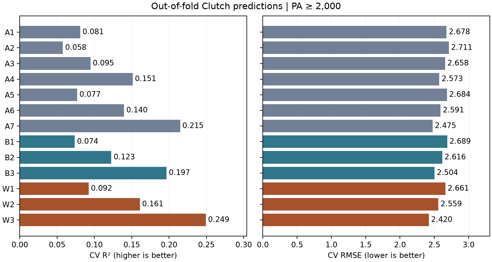

# Appendix A — Ruane BPS, raw differences, and ON/OFF scores

Appendix A compares 13 OLS models with intercepts against the 1998–2025
Baseball-Reference period Clutch estimate. The primary sample comprises the
same 861 players with at least 2,000 Retrosheet PA as in
[Step 3.4](03_4_weighted_benchmark.md). The 1,000 and 3,000 PA samples
contain 1,343 and 595 players. Player IDs, outcomes and five validation
folds match the previous analyses at every cutoff.

## Predictor definitions

Tom Ruane's 2005 study, *In Search of Clutch Hitting*, defined its
unadjusted Clutch Percentage as BPS (batting average plus slugging) with
a runner on second or third minus BPS in all other situations, including
first base only. Ruane treated sacrifice flies as outs and excluded walks
and hit-by-pitches. He used at least 3,000 at-bats including sacrifice flies
for his 1960–2004 player study and separately examined platoon matchups,
opponent pitching strength, and parks alongside the raw differences.
[Original BRJ article](https://sabr.org/journal/article/in-search-of-clutch-hitting/) ·
[Full Retrosheet version and tables](https://www.retrosheet.org/Research/RuaneT/clutch_art.htm)

A1 implements the unadjusted formula on 1998–2025 data and the shared
total-PA samples. For each side, BPS is
`(2 × 1B + 3 × 2B + 4 × 3B + 5 × HR) / T`.
The denominator T counts the four hit types plus the zero-weight group
(outs, including sacrifice flies, and reached on error). Both kinds of
walks, hit-by-pitches, sacrifice bunts and catcher interference are
excluded. This reproduces the published raw statistic's construction
with the project's event coding. It adapts the study's era and sample
selection and omits its contextual analyses and simulations.

A2 (RISP), A3 (LIPS) and A4 (both) use raw ON-minus-OFF hit rates,
with the same trials T as A1 and one unit per hit. A5 (RISP), A6 (LIPS)
and A7 (both) use raw ON-minus-OFF weighted production, with eligible PA
including unintentional walks and hit-by-pitches. They use the
[Step 3.1 fixed weights](03_weighted_on_off.md). All differences require
eligible observations on both sides. The script checks the denominators
and hit totals against Step 1 and the raw differences against Step 3.4.
It refits B1–B3 and W1–W3 and checks their predictions and metrics against
the published Step 3.4 files.

## Primary sample (PA ≥ 2,000)

Pearson r and Spearman ρ describe association between fitted and observed
Clutch. CV metrics pool the five held-out folds, with CV R² measured
relative to the mean Clutch of the entire cutoff sample.

| Method | Predictors | Pearson r | In-sample R² | CV R² | CV RMSE |
|---|---:|---:|---:|---:|---:|
| A1 · Ruane BPS difference | 1 | 0.289 | 0.084 | 0.081 | 2.678 |
| A4 · Raw hit-rate differences | 2 | 0.394 | 0.155 | 0.151 | 2.573 |
| A7 · Raw weighted production differences | 2 | 0.469 | 0.219 | 0.215 | 2.475 |
| B3 · Binomial ON/OFF | 2 | 0.448 | 0.201 | 0.197 | 2.504 |
| W3 · Weighted multinomial ON/OFF | 2 | 0.505 | 0.255 | 0.249 | 2.420 |

### Single-predictor results

| Model and predictor | Pearson r | Spearman ρ | R² | Adjusted R² | CV r | CV R² | CV RMSE | CV MAE |
|---|---:|---:|---:|---:|---:|---:|---:|---:|
| A1 · Ruane BPS difference | .289 | .289 | .084 | .083 | .285 | .081 | 2.678 | 2.089 |
| A2 · Raw RISP hit rate | .247 | .246 | .061 | .060 | .241 | .058 | 2.711 | 2.113 |
| A3 · Raw LIPS hit rate | .311 | .331 | .097 | .096 | .308 | .095 | 2.658 | 2.065 |
| A5 · Raw RISP weighted production | .282 | .280 | .080 | .079 | .277 | .077 | 2.684 | 2.087 |
| A6 · Raw LIPS weighted production | .377 | .401 | .142 | .141 | .374 | .140 | 2.591 | 2.006 |
| B1 · Binomial RISP | .276 | .259 | .076 | .075 | .271 | .074 | 2.689 | 2.097 |
| B2 · Binomial LIPS | .354 | .359 | .125 | .124 | .350 | .123 | 2.616 | 2.034 |
| W1 · Weighted multinomial RISP | .308 | .289 | .095 | .094 | .304 | .092 | 2.661 | 2.071 |
| W2 · Weighted multinomial LIPS | .405 | .413 | .164 | .163 | .401 | .161 | 2.559 | 1.981 |

[All metrics at every PA cutoff](../../Results/Appendix_A/performance.csv).

## Paired bootstrap (PA ≥ 2,000)

Each of 10,000 draws resamples players with replacement, keeping every
player's observed Clutch and all fixed out-of-fold predictions together.
The table shows percentile 95% intervals. Positive values favor the
second model. These intervals do not capture full model-retraining
variability. [All cutoffs](../../Results/Appendix_A/bootstrap_comparisons.csv).

| Comparison | CV R² gain (95% CI) | CV RMSE reduction (95% CI) |
|---|---:|---:|
| A1 → B1 | −.0074 [−.0247, .0108] | −.0107 [−.0357, .0157] |
| A1 → W1 | .0113 [−.0044, .0262] | .0164 [−.0064, .0389] |
| A4 → B3 | .0453 [.0302, .0598] | .0696 [.0444, .0950] |
| A7 → W3 | .0344 [.0195, .0485] | .0548 [.0298, .0796] |

## Interpretation

Ruane's raw RISP BPS difference explains 8.4% of the primary sample's
Clutch variation in sample and 8.1% out of fold. In the RISP-only
comparison, its CV R² is slightly higher than B1's and lower than W1's,
with both paired intervals spanning zero.

Adding LIPS helps even with raw features. CV R² rises from .058 to .151
for hit rates and from .077 to .215 for weighted production. Holding
both situation flags and outcome definitions fixed, the likelihood-ratio
transformation improves CV R² by .045 for hit rates and .034 for
weighted production in the primary sample. At 3,000 PA the weighted
gain falls to .010 and its paired interval spans zero. The binomial gain
is positive with intervals above zero at all three cutoffs.

The closed-form B3 retains about 79% of W3's primary CV R²
(.197/.249 using rounded values), with RMSE 2.504 versus 2.420.
Raw differences need only counts and division. The binomial score
also uses the number of trials on each side to express the evidence
for a difference and needs no numerical optimization. Weighted
multinomial scores differentiate more outcomes and require a
constrained fit. A7 exceeds B3 in CV R² (.215 versus .197), so if
the outcome counts are available, weights alone can provide a useful
benchmark without that fit. The CV comparisons measure prediction
of the period Clutch estimate for held-out players, with all metrics
computed over the same historical period.

RISP and LIPS reduce detailed game states to overlapping binary
flags. They pool different base and out configurations, innings and
score margins, and ignore play-specific leverage and the exact
change in win probability after each play. The models quantify
situational batting performance from those summaries. About 75%
of the primary benchmark variance remains unexplained by W3 out of
fold, and these comparisons do not establish repeatability or a
causal clutch skill.

## Reproduction

From the repository root, using the dependencies in requirements.txt:

    python Script/analyze_appendix_benchmarks.py
    python -m unittest discover -s tests

The script reads the tracked Step 1 through Step 3.4 results. Outputs
include [player metrics](../../Results/Appendix_A/players.csv),
[OLS estimates](../../Results/Appendix_A/coefficients.csv),
and [predictions and fold IDs](../../Results/Appendix_A/predictions.csv).
